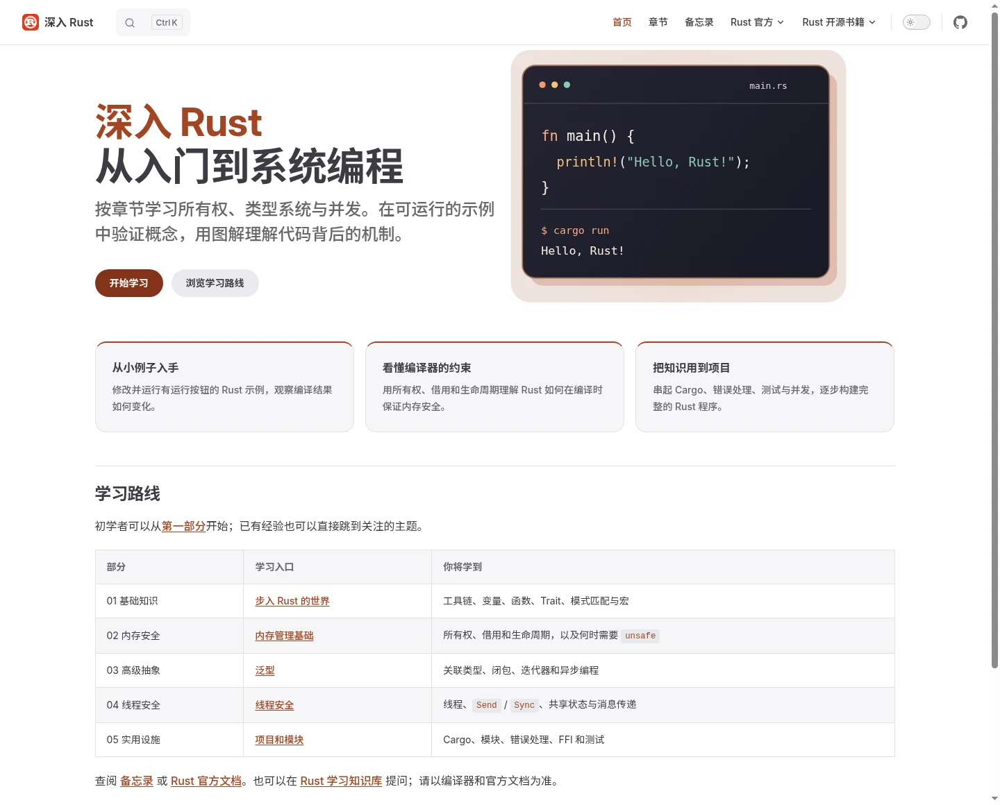
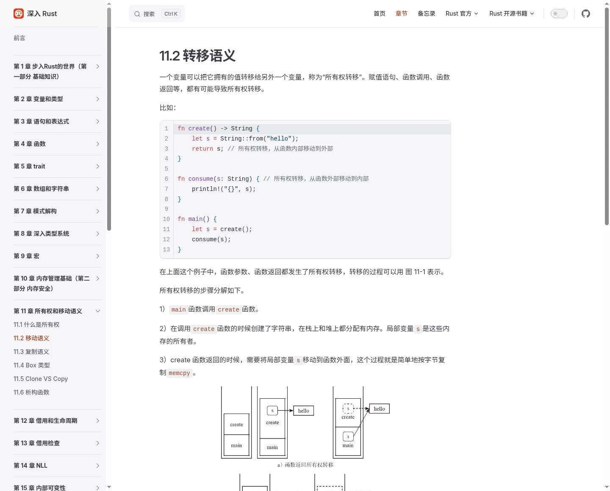
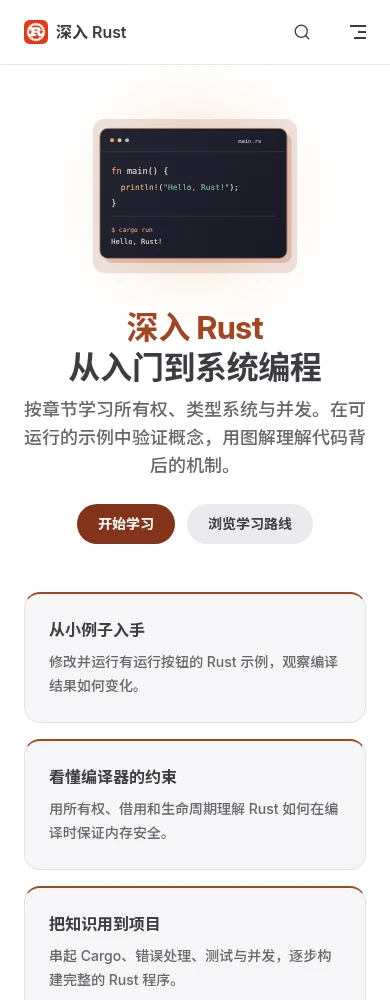

# 深入 Rust

基于《深入浅出 Rust》的中文学习站点。从第一个 Rust 程序开始，按章节学习语法、所有权、并发和工程实践，并通过可运行的示例与图解巩固理解。

**[在线阅读](https://uxiew.github.io/rust_study/)**

## 站点预览



| 章节阅读 | 移动端首页 |
| --- | --- |
|  |  |

## 本地运行

需要 Node.js 24 和 pnpm 9.15.9（版本见 `package.json`）。

```sh
pnpm install --frozen-lockfile
pnpm docs:dev
```

开发服务器启动后，访问 [http://localhost:5173/rust_study/](http://localhost:5173/rust_study/)。

```sh
pnpm docs:build    # 生成 dist/
pnpm docs:preview  # 预览构建产物
```

## 文档检查

见 [Rust 文档审查记录](RUST-REVIEW.md) 和 [逐段编译清单](RUST-EXAMPLES.md)。

本站是学习笔记，并非原书的完整复刻。以官方文档和编译器为准；欢迎在 GitHub 提交勘误。
