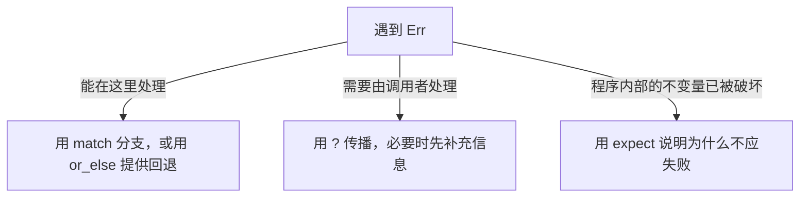

## `unwrap`和`expect`
`unwrap`和`expect`是Rust中用于处理`Result<T, E>`类型的便捷方法，主要用于在错误发生时触发程序 panic，以下是对它们的简要解析：

### **1. `unwrap()`：简单粗暴的错误处理**
- **功能**：当`Result`为`Ok(T)`时，返回其中的`T`值；当为`Err(E)`时，触发 panic 并显示默认错误信息。
- **示例**：
  ```rust
  # use std::fs::File;
  # fn main() {
  let file = File::open("hello.txt").unwrap(); // 若文件不存在，触发 panic
  # }
  ```
- **输出摘要**：
  ```text
  called `Result::unwrap()` on an `Err` value: ...
  ```
- **适用场景**：
  - 调试阶段快速定位问题。
  - 确定操作绝对不会失败（如访问程序内置资源）。


### **2. `expect()`：带自定义错误信息的`unwrap`**
- **功能**：与`unwrap()`类似，但允许传入自定义错误信息，便于调试时快速定位问题。
- **示例**：
  ```rust
  # use std::fs::File;
  # fn main() {
  let file = File::open("hello.txt")
      .expect("错误：文件hello.txt应包含在项目中");
  # }
  ```
- **输出摘要**：
  ```text
  错误：文件hello.txt应包含在项目中: ...
  ```
- **适用场景**：
  - 生产环境中，用明确的错误信息说明“为什么此操作应成功”，提高日志可读性。


### **3. 两者的核心区别**
| 特性               | `unwrap()`                | `expect()`                |
|--------------------|---------------------------|---------------------------|
| **错误信息**       | 默认信息（`called Result::unwrap()`） | 自定义信息（传入的字符串） |
| **调试友好性**     | 较差（需查看错误类型定位问题） | 较好（直接显示问题描述）   |
| **代码意图表达**   | 无（仅表示“我知道这里不会错”） | 明确（说明“为什么应该正确”） |


### **4. 使用建议**
- **优先使用`expect()`**：在生产代码中，通过自定义信息明确操作的前提条件，例如：
  ```rust
  # use std::env;
  # fn main() {
  let config_path = env::var("CONFIG_PATH")
      .expect("环境变量CONFIG_PATH必须设置");
  # }
  ```
- **谨慎使用`unwrap()`**：仅在调试或绝对确定不会出错时使用（如单元测试中验证成功路径）。
- **避免过度使用**：对于可恢复的错误，应优先使用`match`或`?`操作符处理，而非直接panic。

## 更多错误处理方式
在 Rust 中，除了`unwrap`和`expect`，还有多种处理错误的方式，这些方法能更灵活地应对可恢复或不可恢复的错误场景。以下是主要的错误处理方式及应用场景解析：



### **1. `match`表达式：最基础的错误分支处理**
- **核心逻辑**：通过模式匹配区分`Ok`和`Err`分支，分别处理成功值和错误。
- **示例**：
  ```rust
  # use std::fs::File;
  # fn main() {
  let result = File::open("data.txt");
  match result {
      Ok(file) => println!("文件打开成功"),
      Err(error) => eprintln!("打开失败: {}", error),
  }
  # }
  ```
- **优势**：
  - 显式处理成功和失败。Rust 故意丢弃 `Result` 时可用 `let _ = …`；直接丢弃通常会收到 `unused_must_use` 警告。
  - 可针对不同错误类型执行不同逻辑（如区分文件不存在和权限错误）。
- **适用场景**：处理需要差异化逻辑的错误，或需要释放资源的场景。


### **2. `if let`/`while let`：简化单一分支的错误处理**
- **语法糖**：当仅需处理`Ok`或`Err`中的一个分支时，避免`match`的冗长。
- **示例**：
  ```rust
  # use std::fs::File;
  # fn process_file(_file: File) {}
  # fn main() {
  // 仅处理成功情况，错误被忽略（不推荐）
  if let Ok(file) = File::open("data.txt") {
      process_file(file);
  }

  // 处理错误情况
  if let Err(error) = File::open("data.txt") {
      eprintln!("错误: {}", error);
  }
  # }
  ```
- **注意**：忽略错误不会破坏内存安全，但可能丢失有用的故障信息；有需要时用 `else` 或 `match` 处理。


### **3. `?`操作符：函数级错误传播**
- **功能**：提前向当前函数的调用者返回 `Err`，而不是像异常那样跨函数展开栈；必要时用 `From` 转换错误。
- **示例**：
  ```rust
  use std::fs::File;
  use std::io::{self, Read};

  fn read_file() -> Result<String, io::Error> {
      let mut file = File::open("data.txt")?;  // 错误直接返回
      let mut content = String::new();
      file.read_to_string(&mut content)?;
      Ok(content)
  }
  ```
- **底层实现**：等价于`match`处理`Err`并返回，`Ok`则继续执行。
- **适用场景**：函数需要将错误向上层传递，避免层层嵌套的`match`。


### **4. `try_from`和`try_into`：类型转换错误处理**
- **基于`TryFrom`/`TryInto` trait**：处理可能失败的类型转换。
- **示例**：
  ```rust
  # fn main() {
  // 将较大的整数转换成 u8；超出范围时返回错误
  let num: Result<u8, _> = 123_i32.try_into();
  match num {
      Ok(n) => println!("数字: {}", n),
      Err(_) => eprintln!("转换失败"),
  }
  # }
  ```
- **扩展**：可自定义类型的`TryFrom`实现，统一错误处理逻辑。
- **区别**：如果是从字符串解析数字，则用 `"123".parse::<i32>()`，不是 `try_into()`。


### **5. `Result::map`/`map_err`：转换结果和错误类型**
- **函数式风格处理**：
  - `map(|x| x.transform())`：转换`Ok`中的值，错误保持不变。
  - `map_err(|e| CustomError::from(e))`：转换错误类型。
- **示例**：
  ```rust
  # fn main() {
  let result: Result<String, String> = std::fs::read_to_string("data.txt")
      .map(|content| content.trim().to_owned())
      .map_err(|e| format!("文件操作错误: {}", e));
  # }
  ```
- **适用场景**：需要将底层错误包装为自定义错误，或处理结果前转换数据。


### **6. `Result::and_then`/`or_else`：链式操作**
- **链式处理多个`Result`**：
  - `and_then(|x| next_operation(x))`：仅当前面为`Ok`时执行后续操作。
  - `or_else(|e| handle_error(e))`：仅当前面为`Err`时执行错误处理。
- **示例**：
  ```rust
  # fn main() {
  let result: Result<u32, String> = std::fs::read_to_string("config.txt")
      .map_err(|e| e.to_string())
      .and_then(|text| text.trim().parse::<u32>().map_err(|e| e.to_string()))
      .or_else(|e| {
          eprintln!("处理失败: {}", e);
          Ok(Default::default())  // 错误时返回默认值
      });
  # }
  ```
- **优势**：避免嵌套`match`，保持代码线性结构。


### **7. 自定义错误类型：封装业务逻辑错误**
- **通过`Error` trait**：定义包含多种错误类型的枚举，并实现`std::error::Error`。
- **示例**：
  ```rust
  use std::error::Error;
  use std::io;

  // 自定义错误枚举
  #[derive(Debug)]
  enum AppError {
      IoError(io::Error),
      ParseError(String),
  }

  // 实现Error trait
  impl Error for AppError {
      fn source(&self) -> Option<&(dyn Error + 'static)> {
          match self {
              AppError::IoError(e) => Some(e),
              AppError::ParseError(_) => None,
          }
      }
  }

  impl std::fmt::Display for AppError {
      fn fmt(&self, f: &mut std::fmt::Formatter<'_>) -> std::fmt::Result {
          match self {
              AppError::IoError(e) => write!(f, "IO错误: {}", e),
              AppError::ParseError(s) => write!(f, "解析错误: {}", s),
          }
      }
  }

  impl From<io::Error> for AppError {
      fn from(error: io::Error) -> Self {
          Self::IoError(error)
      }
  }

  // 使用自定义错误
  fn process_data() -> Result<u32, AppError> {
      let data = std::fs::read_to_string("data.txt")?;
      let value = data.trim().parse::<u32>()
          .map_err(|e| AppError::ParseError(e.to_string()))?;
      Ok(value)
  }
  ```
- **优势**：
  - 统一业务错误处理，便于上层调用者区分不同错误类型。
  - 支持错误链（通过`source()`方法追溯原始错误）。


### **8. `std::panic::catch_unwind`：捕获panic**
- **功能**：将展开栈的 panic 捕获为 `Err`；不能捕获 `panic = "abort"`，也不能替代普通的 `Result` 错误处理。
- **示例**：
  ```rust
  use std::fs::File;
  use std::panic;
  # fn process_file(_file: File) {}

  # fn main() {
  let result = panic::catch_unwind(|| File::open("data.txt").unwrap());

  match result {
      Ok(file) => process_file(file),
      Err(_) => eprintln!("捕获到 panic"),
  }
  # }
  ```
- **适用场景**：
  - 隔离组件中允许展开栈的 Rust panic，例如在框架的任务边界捕获。
  - 在 FFI 边界内处理 Rust panic，不能依赖它捕获外部语言异常或接住已越过不允许展开的 ABI 边界的 panic。


### **9. 组合结果与迭代器的 `all`/`any`**
- **组合多个结果**：
  - 稳定版可用 `and_then` 与 `map` 合并两个 `Result`，仅当都为 `Ok` 时得到 `Ok((a, b))`。
  - `results.iter().all(|r| r.is_ok())`：检查是否全部成功；空迭代器返回 `true`。
  - `results.iter().any(|r| r.is_err())`：检查是否有结果失败；空迭代器返回 `false`。
- **示例**：
  ```rust
  # fn main() {
  let result1: Result<i32, &str> = Ok(10);
  let result2: Result<i32, &str> = Err("错误");

  // 合并结果
  let combined = result1.and_then(|a| result2.map(|b| (a, b)));
  assert_eq!(combined, Err("错误"));

  // 批量处理
  let results = vec![Ok(1), Ok(2), Err("失败")];
  assert!(!results.iter().all(|r| r.is_ok()));
  assert!(results.iter().any(|r| r.is_err()));
  # }
  ```


### **10. `thiserror`和`anyhow`：第三方错误处理库**
- **`thiserror`**：简化自定义错误类型的实现，通过宏生成 `Display` 和 `Error` 等实现。需要依赖 `thiserror`。
  ```rust,cargo=thiserror,no_run
  // Cargo.toml 中添加：thiserror = "2"
  use std::io;
  use thiserror::Error;

  #[derive(Error, Debug)]
  enum AppError {
      #[error("IO错误: {0}")]
      Io(#[from] io::Error),

      #[error("配置错误: {0}")]
      Config(String),
  }
  ```
- **`anyhow`**：提供 `Result<_, anyhow::Error>`；`?` 可传播满足条件的错误，无需定义错误枚举。需要依赖 `anyhow`，下例解析 JSON 还需要 `serde_json`。
  ```rust,cargo=anyhow+serde_json,no_run
  // Cargo.toml 中添加：anyhow = "1" 和 serde_json = "1"（各一行）
  use anyhow::{Context, Result};

  fn process() -> Result<()> {
      let data = std::fs::read_to_string("file.txt").context("读取 file.txt 失败")?;
      let value: serde_json::Value = serde_json::from_str(&data).context("解析 JSON 失败")?;
      Ok(())
  }
  ```
- **优势**：减少样板代码，适合快速开发或中小型项目。


### **错误处理策略总结**
| 方法                | 核心特点                                                                 | 推荐场景                          |
|---------------------|--------------------------------------------------------------------------|-----------------------------------|
| `match`             | 显式处理所有分支，逻辑清晰                                               | 复杂错误分支、资源释放            |
| `?`操作符           | 函数级错误传播，保持代码线性                                             | 库函数、需要向上层传递错误的场景  |
| `map`/`map_err`     | 转换结果或错误类型                                                       | 错误包装、结果预处理              |
| `and_then`/`or_else` | 链式操作，避免嵌套                                                       | 多步操作串联、错误降级处理        |
| 自定义错误类型      | 封装业务逻辑，支持错误链                                                 | 大型项目、需要区分错误类型的场景  |
| `thiserror`/`anyhow` | 第三方库，简化错误处理实现                                               | 快速开发、中小型项目              |


### **最佳实践建议**
1. **优先使用`?`操作符**：在函数中尽量通过`?`传播错误，避免层层`match`。
2. **区分可恢复与不可恢复错误**：
   - 可恢复错误（如文件不存在）：用`match`处理并给出解决方案。
   - 不可恢复错误（如程序内部逻辑错误）：用`expect`并附带明确错误信息。
3. **自定义错误类型**：在库代码中定义专属错误类型，便于调用者处理。
4. **避免过度使用`unwrap`**：仅在调试或绝对确定不会出错时使用（如单元测试）。
5. **结合第三方库**：在应用程序中使用`anyhow`简化错误处理，在库中使用`thiserror`定义清晰的错误类型。

通过灵活组合这些方法，可在 Rust 中构建健壮、清晰的错误处理体系，同时保持代码的可读性和安全性。
