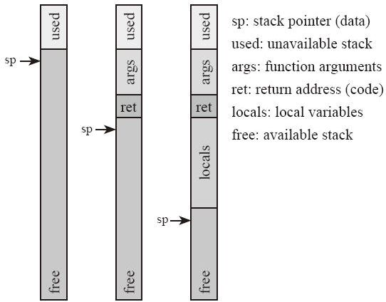
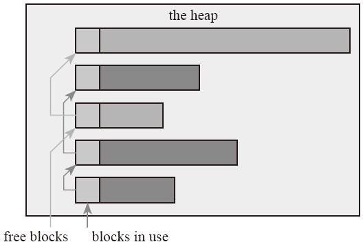

# 10.1 堆和栈

进程的虚拟地址空间通常包括程序代码、静态数据、线程的调用栈，以及分配器管理的动态内存。实际布局取决于系统和编译目标；优化器也可以直接用寄存器保存局部值。

| | 栈 | 堆 |
| --- | --- | --- |
| 适合存什么 | 函数调用所需的局部状态。 | 动态分配、大小可变或需转移所有权的数据。 |
| 怎样收回空间 | 函数返回时回收相应的栈帧。 | 由分配器收回；Rust 的拥有者（如 `Box` 或 `Vec`）通常在析构时归还分配。 |
| 常见限制 | 每个线程的栈通常有大小限制。 | 分配可能失败，且有分配和间接访问成本。 |

栈帧遵循后进先出。函数调用时建立栈帧，返回时移除；并不要求所有参数或返回地址都经过栈。

与栈帧不同，堆上各块可按独立的顺序分配和释放。比如，移动一个 `Box<u32>` 会转移其管理的分配，不需要把堆上的整数再分配一次。

> 图源：[What and where are the stack and heap?](https://stackoverflow.com/questions/79923/what-and-where-are-the-stack-and-heap)
