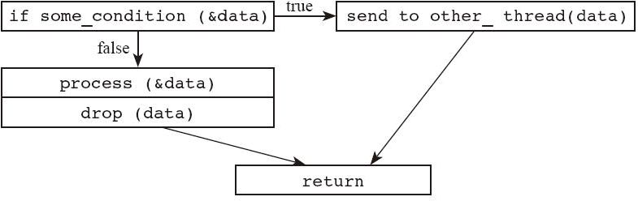
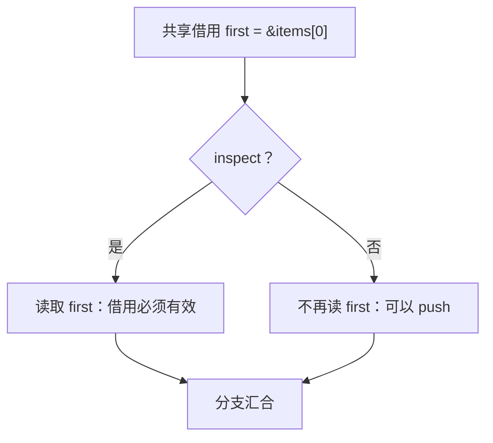

# 14.2 NLL 的原理

NLL 的设计目的是让“借用”的生命周期不要过长，适可而止，避免不必要的编译错误，把实际上正确的代码也一起拒绝掉。但是实现方法不能是简单地在 AST 上找一下某个引用最后一次在哪里使用，就让它的生命周期结束算了。我们用例子来说明：

---

预期编译错误：（E0499）下一轮循环仍会使用 `slice`，与循环体的 `push` 冲突。

```rust,compile_fail,no_run
fn capitalize(data: &mut [char]) { for c in data { c.make_ascii_uppercase(); } }
fn baz() {
    let mut data = vec!['a', 'b', 'c'];
    let slice = &mut data[..]; // <-+ lifetime if we ignored
    for _ in 0..2 {
        capitalize(slice);
        data.push('d'); // 下一轮还会使用 slice
    }
}
fn main() { baz(); }
```

---

在这个示例中，我们引入了一个循环结构。如果我们只是分析 AST 的结构的话，很可能会觉得`capitalize`函数结束后，`slice`的生命周期就结束了，因此`data.push()`方法调用是合理的。但这个结论是错误的，因为这里有一个循环结构。大家想想看，如果执行了`push()`方法后，引发了 Vec 数据结构的扩容，它把以前的空间释放掉，申请了新的空间，进入下一轮循环的时候，slice 就会指向一个非法地址，会出现内存不安全。以上这段代码理应出现编译错误。

借用检查器在 MIR（中层中间表示）上分析控制流。MIR 使循环回边和条件分支显式可见。以下命令可将 MIR 写成可读的文本：

```sh
rustc --edition 2024 --emit=mir test.rs
```

不过在一般情况下，MIR 在编译器内部的表现形式是内存中的一组数据结构。这些数据结构描述的是一个叫作“控制流图”（control flow graph）的概念。所谓控制流图，就是用“图”这种数据结构，描述程序的执行流程。每个函数都有一个 MIR 来描述它，比如对于以下这段代码：

```rust
struct Data;
fn some_condition(data: &[Data]) -> bool { !data.is_empty() }
fn send_to_other_thread(data: Vec<Data>) { drop(data); }
fn process(data: &[Data]) { assert!(data.is_empty()); }
fn send_if2(data: Vec<Data>) {
    if some_condition(&data) {
        send_to_other_thread(data);
        return;
    }

    process(&data);
}
fn main() { send_if2(vec![]); send_if2(vec![Data]); }
```

生成的控制流图如图 14-1 所示。

图上面有节点，也有边。节点代表一条或者一组语句，边代表分支跳转。有了这个图，引用的生命周期就可以用这个图上的节点来表示了。编译器最后会分析出来，引用在这个图上的哪些节点上还是活着的，在哪些节点上可以看作已经死掉了。相比于以前，一个引用的生命周期直接充满整个语句块，现在的表达方式明显要精细得多，这样我们就可以保证引用的生命周期不会被过分拉长。



*图 14-1*

这个新版的借用分析器，会允许下面的代码编译成功，比如：

```rust
fn main() {
    let mut v = vec![1,2,3,4,5];
    v.push(v.len()); // 接收者的两阶段借用允许先求值 v.len()。
    println!("{:?}", v);
}
```

再比如：

```rust
fn main() {
    let mut data = 100_i32;
    let mut p = &data; // p is live
    println!("{}", p); // p is dead

    data = 101;
    p = &data;         // p is live again
    println!("{}", p); // p is dead again
}
```

`p` 绑定没有消失；第一次打印后，原来的借用不再需要活跃。赋值不会和它冲突，`p = &data` 再引入新的借用。

另外需要强调的是：

* 这个功能只影响静态分析结果，不影响程序的执行情况；

* 可以放行旧检查器过度保守地拒绝的程序，并不是对所有历史程序的兼容承诺；

* 它依然保证了安全性，只是将以前过于保守的检查规则适当放宽；

* 它依赖的依然是静态检查规则，不会涉及任何动态检查规则；

* 它只影响“引用类型”的生命周期，不影响“对象”的生命周期，即维持现有的析构函数调用时机不变；

* 它不会影响 RAII 语义。

今天无需启用实验选项；所有 Edition 都使用 NLL。

以下再用一个分支说明：只有读取路径会使用 `first`，扩容路径不会。

```rust
fn inspect_or_extend(items: &mut Vec<i32>, inspect: bool) {
    let first = &items[0];
    if inspect {
        println!("{first}");
    } else {
        items.push(3); // 此路径不再读取 first
    }
}

fn main() {
    let mut items = vec![1, 2];
    inspect_or_extend(&mut items, true);
    inspect_or_extend(&mut items, false);
    assert_eq!(items, [1, 2, 3]);
}
```


