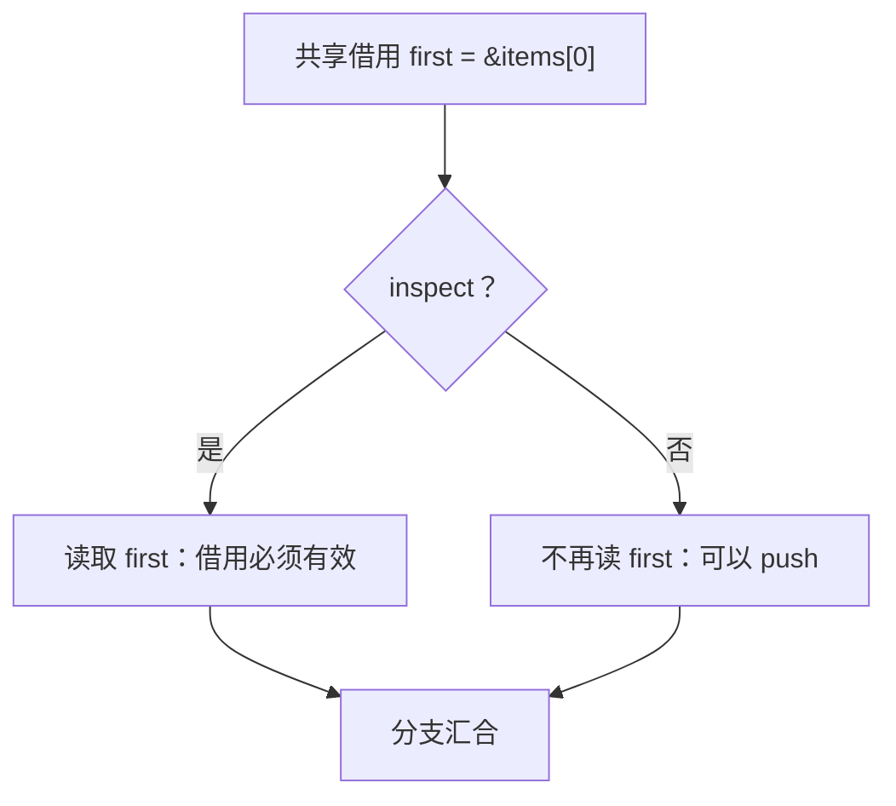

# 14.2 NLL 的原理

借用检查器在 MIR（中间表示）的控制流图上求解约束。借用必须覆盖所有需要它有效的程序点；如果不同路径上的用途不同，检查结果也能不同。

```rust
fn inspect_or_extend(items: &mut Vec<i32>, inspect: bool) {
    let first = &items[0];
    if inspect {
        println!("{first}");
    } else {
        items.push(3); // 此路径不再读取 first
    }
}

fn main() {
    let mut items = vec![1, 2];
    inspect_or_extend(&mut items, true);
    inspect_or_extend(&mut items, false);
    assert_eq!(items, [1, 2, 3]);
}
```



| 容易混淆 | 这个例子里发生了什么 |
| --- | --- |
| 绑定的作用域 | `first` 的名字在函数块末尾才不可见。 |
| 借用活跃的程序点 | 读取 `first` 的路径必须保留共享借用；另一路径不需要。 |
| 被借用值的析构 | NLL 不会提前析构 `Vec`；该值仍由调用方持有。 |

对实现了 `Drop` 的守卫来说，析构也可能需要用到它持有的借用。例如，要提前交还 `RefCell` 的动态借用，使用小作用域或显式 `drop(guard)`，而不是只停止读取守卫。
