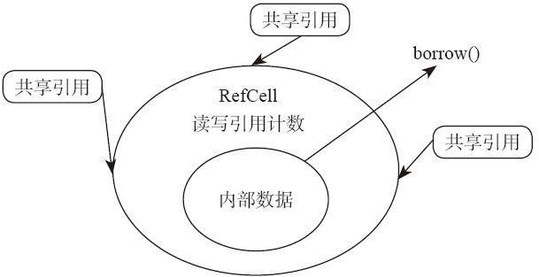
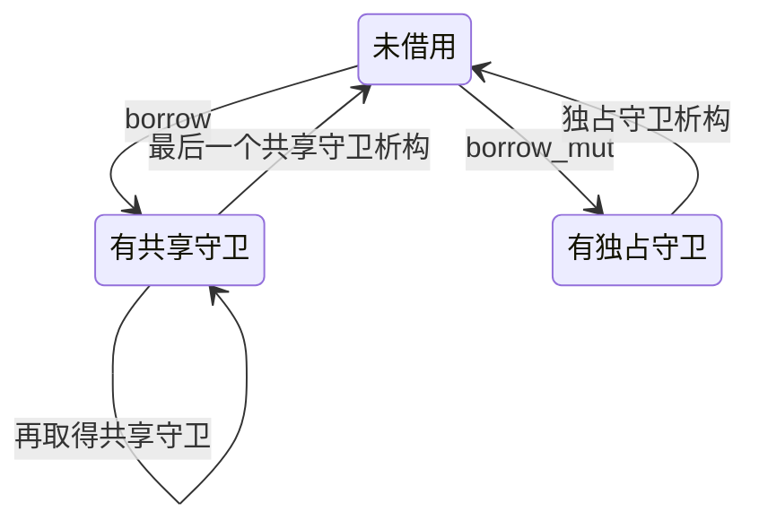

# 15.2 RefCell

RefCell 是另外一个提供了内部可变性的类型。它提供的方式与 Cell 类型有点不一样。Cell 类型没办法制造出直接指向内部数据的指针，而 RefCell 可以。我们来看一下它的 API：

```text
impl<T: ?Sized> RefCell<T> {

    pub fn borrow(&self) -> Ref<'_, T> {    }

    pub fn try_borrow(&self) -> Result<Ref<'_, T>, BorrowError> {    }

    pub fn borrow_mut(&self) -> RefMut<'_, T> {    }

    pub fn try_borrow_mut(&self) -> Result<RefMut<'_, T>, BorrowMutError> {    }

    pub fn get_mut(&mut self) -> &mut T {    }

    pub fn as_ptr(&self) -> *mut T { … }
}
```

`get_mut` 方法与 `Cell::get_mut` 一样，可以通过 `&mut self` 获得 `&mut T`，这个过程是安全的。除此之外，RefCell 最主要的两个方法就是 `borrow` 和 `borrow_mut`，另外两个 `try_borrow` 和 `try_borrow_mut` 只是它们俩的镜像版，区别仅在于错误处理的方式不同。

我们还是用示例来演示一下 RefCell 怎样使用：

```rust
use std::cell::RefCell;

fn main() {
    let shared_vec: RefCell<Vec<isize>> = RefCell::new(vec![1, 2, 3]);
    let shared1 = &shared_vec;
    let shared2 = &shared1;

    shared1.borrow_mut().push(4);
    println!("{:?}", shared_vec.borrow());

    shared2.borrow_mut().push(5);
    println!("{:?}", shared_vec.borrow());
}
```

在这个示例中，我们用一个 RefCell 包了一个 Vec，并且制造了另外两个共享引用指向同一个 RefCell。这时，我们可以通过任何一个共享引用调用`borrow_mut`方法，获得指向内部数据的“可写”指针，通过这个指针调用了 `push` 方法，修改内部数据。同时，我们也可以通过调用 borrow 方法获得指向内部数据的“只读”指针，读取 Vec 里面的值。

编译，执行，结果为：

```text
[1, 2, 3, 4]
[1, 2, 3, 4, 5]
```

这里有一个小问题需要跟大家解释一下：在函数的签名中，`borrow` 方法和 `borrow_mut` 方法返回的并不是 `&T` 和 `&mut T`，而是 `Ref<T>` 和 `RefMut<T>`。它们实际上是一种“智能指针”，完全可以当作 `&T` 和 `&mut T`的等价物来使用。标准库之所以返回这样的类型，而不是原生指针类型，是因为它需要这个指针生命周期结束的时候做点事情，需要自定义类型包装一下，加上自定义析构函数。至于包装起来的类型为什么可以直接当成指针使用，它的原理可以参考下一章“解引用”。

那么问题来了：如果 `borrow` 和 `borrow_mut` 这两个方法可以制造出指向内部数据的只读、可读写指针，那么它是怎么保证安全性的呢？像前几章讲的那样，如果同时构造了只读引用和可读写引用指向同一个 Vec，那不是很容易就构造出悬空指针么？答案是，RefCell 类型放弃了编译阶段的 alias+mutation 原则，但依然会在执行阶段保证 alias+mutation 原则。示例如下：

```rust
use std::cell::RefCell;

fn main() {
    let shared_vec: RefCell<Vec<isize>> = RefCell::new(vec![1, 2, 3]);
    let shared1 = &shared_vec;
    let shared2 = &shared1;

    let p1 = shared1.borrow();
    let p2 = &p1[0];

    shared2.borrow_mut().push(4);
    println!("{}", p2);
}
```

上面这个示例的意图是：我们先调用 `borrow` 方法，并制造一个指向数组第一个元素的指针，接着再调用 `borrow_mut` 方法，修改这个数组。
这样，就构造出了同时出现 alias 和 mutation 的场景。

这里故意触发 panic：读守卫仍存活，`borrow_mut` 无法独占。

```text
thread 'main' panicked at …:
RefCell already borrowed
```

出现 panic 的原因是，RefCell 探测到同时出现了 alias 和 mutation 的情况，它为了防止更糟糕的内存不安全状态，直接使用了 panic 来拒绝程序继续执行。
改用 `try_borrow_mut` 可以获得 `Err(BorrowMutError)` 而不是 panic。

那么 RefCell 是怎么探测出问题的呢？原因是，RefCell 内部有一个“借用计数器”，调用 `borrow` 方法的时候，计数器里面的“共享引用计数”值就加 `1`。
当这个 `borrow` 结束的时候，会将这个值自动减 `1`（如图 15-2 所示）。
同样，`borrow_mut` 方法被调用的时候，它就记录一下当前存在“可变引用”。
如果“共享引用”和“可变引用”同时出现了，就会报错。



*图 15-2*

这个规则像读写锁：允许多个读者，或者一个写者。`RefCell` 在运行时通过借用状态维护这一条件，不会阻塞等待，也不是跨线程的锁。检查随 `Ref` 和 `RefMut` 守卫的创建和析构执行，有少量运行成本。

所以说，我们一定不要过于滥用 RefCell 这样的类型。如果确有必要使用，请一定规划好动态借用出来的指针存活时间，否则会在执行阶段有问题。

Cell 和 RefCell 用得最多的场景是和多个只读引用相配合。比如，多个 `&` 引用或者 Rc 引用指向同一个变量的时候。
我们不能直接通过这些只读引用修改变量，因为既然存在 alias，就不能提供 mutation。为了让存在多个 alias 共享的变量也可以被修改，那我们就需要使用内部可变性。

Rust 中提供了只读引用的类型有 `&`、`Rc`、`Arc` 等指针，它们可以提供 alias。Rust 中提供了内部可变性的类型有 `Cell`、`RefCell`、`Mutex`、`RwLock` 以及 `Atomic*`系列类型等。这两类类型经常需要配合使用。

如果你需要把一个类型 T 封装到内部可变性类型中去，要怎样选择 Cell 和 RefCell 呢？原则就是，如果你只需要整体性地存入、取出 T，那么就选 Cell。
如果你需要有个可读写指针指向这个 T 修改它，那么就选 RefCell。



需要先读后写时，可以缩短守卫的存活时间：

```rust
fn main() {
    use std::cell::RefCell;

    let values = RefCell::new(vec![1, 2, 3]);
    let read = values.borrow();
    assert_eq!(read[0], 1);
    assert!(values.try_borrow_mut().is_err());
    drop(read);
    values.borrow_mut().push(4);
    assert_eq!(*values.borrow(), [1, 2, 3, 4]);
}
```
