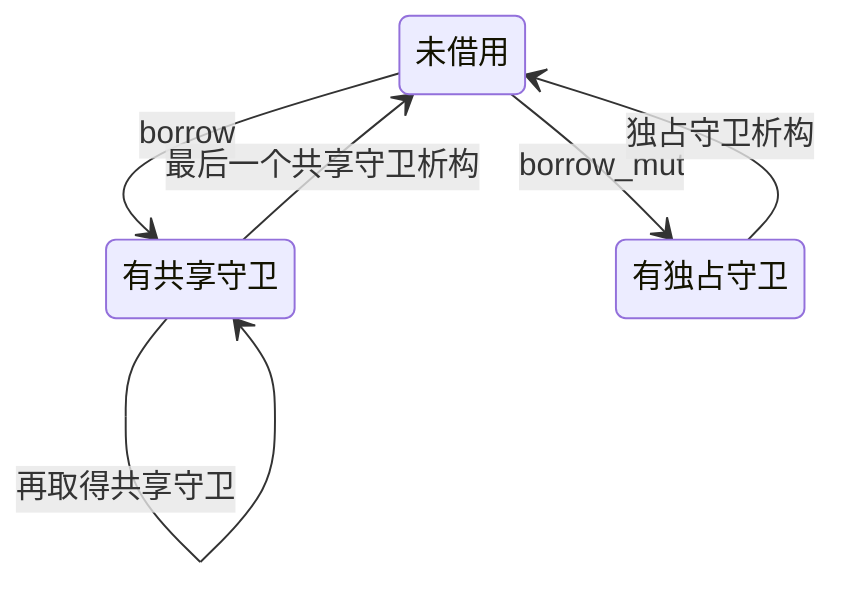

# 15.2 RefCell

[`RefCell<T>`](https://doc.rust-lang.org/std/cell/struct.RefCell.html) 将借用冲突的检查移到运行时。可以同时有多个共享借用，或者独占地取得一个可变借用。它返回带析构逻辑的守卫：丢弃 `Ref` 或 `RefMut` 才会归还相应的动态借用。

```rust
fn main() {
    use std::cell::RefCell;

    let values = RefCell::new(vec![1, 2, 3]);
    let read = values.borrow();
    assert_eq!(read[0], 1);
    assert!(values.try_borrow_mut().is_err());
    drop(read);
    values.borrow_mut().push(4);
    assert_eq!(*values.borrow(), [1, 2, 3, 4]);
}
```



从「有共享守卫」直接申请独占借用会失败；已有独占守卫时，申请任何新借用都会失败。`borrow` 和 `borrow_mut` 在冲突时 panic；对应的 `try_borrow` 和 `try_borrow_mut` 返回错误。若已有 `&mut RefCell<T>`，可直接用 `get_mut`，不需要动态检查。
