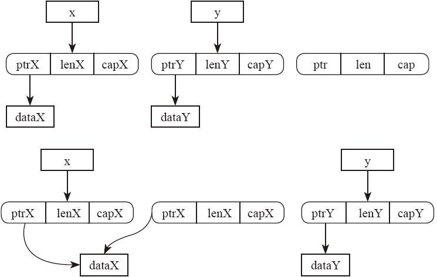
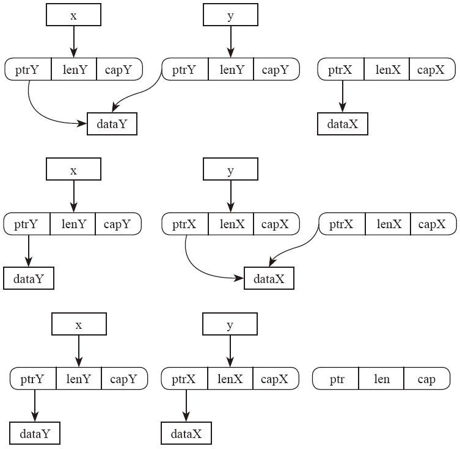

# 19.3 内置函数

`core::intrinsics` 是编译器内置函数的底层入口，其中许多不是稳定的公开接口。下面用 `std::mem` 和 `std::ptr` 中可用于稳定 Rust 的封装说明。

下面就在这些函数中挑一部分作介绍。

## 19.3.1 transmute

[`mem::transmute`](https://doc.rust-lang.org/std/mem/fn.transmute.html) 按位转换同样大小的类型。大小相同不是充分条件：结果还必须满足目标类型的有效性，例如只有 0 和 1 是合法的 `bool` 表示。不应把 `transmute` 当作通用类型转换。

| 需求 | 优先使用 |
| --- | --- |
| 浮点数与位模式互转 | `f32::to_bits` / `f32::from_bits` |
| 从字节解码整数 | `from_le_bytes`、`from_be_bytes` |
| 把一个值从字段中移出，同时留下新值 | `mem::replace` 或 `mem::take` |

例如原书尝试把 `Vec` 转成三个整数来观察指针、长度和容量，但 `Vec` 不保证这些成员的布局次序。要观察这三个量，分别用 `as_ptr`、`len` 和 `capacity`。

## 19.3.2 内存读写

这些操作分别在 `std::ptr` 或 `std::mem` 中提供。以下按数据流方向来读。

1. `copy`

`ptr::copy` 从 `src` 到 `dst` 复制 `count` 个 `T` 大小的槽位，允许重叠，类似 C 的 `memmove`；`count` 是元素个数，不是字节数。

这个模块中还提供了`ptr::copy_nonoverlapping`。它跟 C 语言里面的 memcpy 很像，都假设用户已经保证了 src 和 dst 指向的内容不可重叠。所以 `tr::copy_nonoverlapping`的执行速度比`ptr::copy`要快一些。

2. `write`

在 ptr 模块中，write 的签名是`unsafe fn write<T>(dst: *mut T, src: T)`，作用是把变量 src 写入到 dst 所指向的内存中。注意它的参数 src 是使用的类型 T，执行的是 move 语义。查看源码可知，它是基于`intrinsics::move_val_init`实现的。注意，在写的过程中，不管 dst 指向的内容是什么，都会被直接覆盖掉。而 src 这个对象也不会执行析构函数。

写内存还有`ptr::write_bytes`、`ptr::write_unaligned`、`ptr::write_volatile`等函数。

3. `read`

`ptr::read` 从有效地址读取已初始化的 `T`，却不会清空地址中的字节。非 `Copy` 值必须确保原位置不再被当作仍拥有该值而析构。

读内存还有`ptr::read_unaligned`以及`ptr::read_volatile`两个函数，大同小异。

这些裸指针操作需要调用者证明对齐、有效性以及相应的所有权条件。是否允许重叠、未初始化数据或非对齐地址，取决于具体 API。

4. `swap`

在 ptr 模块中，swap 的签名是`unsafe fn swap<T>（x: *mut T, y: *mut T)`，作用是把两个指针指向的内容做交换。两个指针所指向的对象都只是被修改，而不会被析构。

`mem::swap<T>(x: &mut T, y: &mut T)` 是安全函数。两个合法的可变引用已经表达了交换所需要的有效性和独占访问。

某些特殊类型还有自己的 swap 成员函数。比如`Cell::swap(&self, other：&Cell<T>)`。这个函数跟其他`swap`函数最大的区别在于，它的参数只要求共享引用，不要求可变引用。这是因为 Cell 本身的特殊性。它具备内部可变性，所以这么设计是完全安全的。我们可以从源码看到，它就是简单地调用了`ptr::swap`。

5. `drop_in_place`

在 ptr 模块中，`drop_in_place`的签名是`unsafe fn drop_in_place<T: ?Sized>(to_drop: *mut T)`。它的作用是执行当前指向对象的析构函数，如果没有就不执行。

6. `MaybeUninit`

`mem::uninitialized` 已弃用：甚至在填充之前，某些类型一旦被构造成无效值就会有未定义行为。`MaybeUninit<T>` 保存存储而不声称它已经是一个有效的 `T`；只有已写入有效的 `T` 才能 `assume_init`。

## 19.3.3 综合示例

下面我们用一个示例来演示一下这些 unsafe 函数的用途，以及怎样才能正确调用 unsafe 代码。示例很简单，就是实现标准库中的内存交换函数 `std::mem::swap`。

我们可以确定这个函数的签名是 `fn swap<T>(x: &mut T, y: &mut T)`。关于泛型的解释在第 21 章中有，此处略过不提。先试一个最简单的实现：

---

预期编译错误：（E0507）不能通过借用移出任意非 `Copy` 的值。

```rust,compile_fail,no_run
fn swap<T>(x: &mut T, y: &mut T) {
    let z : T = *x;
    *x = *y;
    *y = z;
}
```

---

编译不通过。因为`let z = *x;`执行的是 move 语义，编译器不允许我们把 x 指向的内容 move 出来，这只是一个借用而已。如果允许执行这样的操作，会导致原来的借用指针 x 指向非法数据。但是我们知道，我们这个函数整体上是可以保证安全的，因为我们把 x 指向的内容 move 出来之后，会用其他的正确数据填回去，最终可以保证函数执行完之后，x 和 y 都是一个正常的状态。这种时候，我们就需要动用 unsafe 了，代码如下：

---

```rust
use std::{mem::MaybeUninit, ptr};

fn exchange<T>(x: &mut T, y: &mut T) {
    let mut temporary = MaybeUninit::<T>::uninit();
    // SAFETY: x 和 y 是独立的有效可变借用；中转槽与两者均不重叠。
    // 过程不会运行析构，也不把中转槽重复视为有所有权的 T。
    unsafe {
        ptr::copy_nonoverlapping(x, temporary.as_mut_ptr(), 1);
        ptr::copy_nonoverlapping(y, x, 1);
        ptr::copy_nonoverlapping(temporary.as_ptr(), y, 1);
    }
}

fn main() {
    let (mut a, mut b) = (vec![1, 2], vec![3]);
    exchange(&mut a, &mut b);
    assert_eq!((a, b), (vec![3], vec![1, 2]));
}
```

---

代码逻辑的意思如下。

首先要有一个中转槽；`MaybeUninit` 提供空间，不要求构造任意 `T` 的默认值。

随后做三次拷贝：把 `x` 的字节保存到中转槽，把 `y` 的字节写到 `x`，再把中转槽写到 `y`。中间不让任何访问者把副本当作额外的所有者，也不在尚未恢复不变量时运行用户代码。

中转槽不是一个需要析构的 `T`。如果交换的是两个 `Vec`，移动的是它们的拥有者状态，而不是复制两份堆上元素。业务代码请直接调用 `mem::swap`；上面的实现用于理解图中的三个阶段。



图 19-1



图 19-1（续）

实际读入整数时，不需要这些底层操作。例如用字节数组直接解码小端输入：

```rust
use std::io::{self, Read};

fn read_u32_le(reader: &mut impl Read) -> io::Result<u32> {
    let mut bytes = [0; 4];
    reader.read_exact(&mut bytes)?;
    Ok(u32::from_le_bytes(bytes))
}

fn main() -> io::Result<()> {
    assert_eq!(read_u32_le(&mut &[0x78, 0x56, 0x34, 0x12][..])?, 0x1234_5678);
    assert_eq!(read_u32_le(&mut &[1, 2][..]).unwrap_err().kind(), io::ErrorKind::UnexpectedEof);
    Ok(())
}
```
