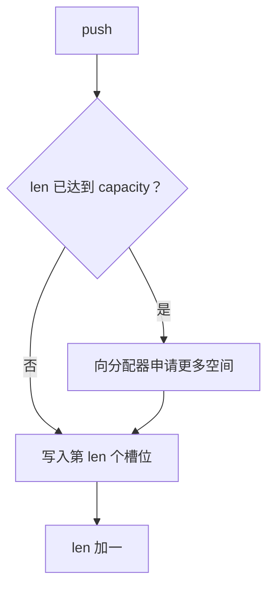

# 20.2 内存扩容

Rust 1.100.0 中，`Vec::push` 调用 `push_mut`。后者在容量不足时先让 `RawVec` 扩容，再向末尾写入元素，最后增加 `len`。扩容可以移动整个缓冲区，因此不能在原来的引用仍活跃时借用 `&mut Vec<T>` 执行 `push`。



当前实现的摊还增长取所需容量、旧容量的两倍和最小非零容量的最大值，再检查分配布局。这不是公开的增长倍率保证；不要写断言依赖容量一定翻倍。

```rust
fn main() -> Result<(), std::collections::TryReserveError> {
    let mut values = vec![10_u32, 20];
    values.try_reserve(3)?;
    assert!(values.capacity() >= values.len() + 3);
    values.extend([30, 40, 50]);
    assert_eq!(values.len(), 5);
    Ok(())
}
```

`reserve(additional)` 与 `try_reserve(additional)` 的参数是**相对当前长度**的额外元素数，不是最终容量。`try_reserve` 可以把容量溢出或分配器报告的失败作为错误返回；`reserve_exact` 不会刻意多预留，但也不能保证分配器返回恰好所请求的容量。
