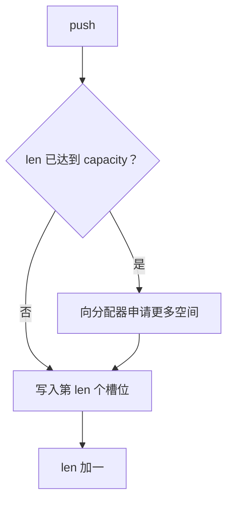

# 20.2 内存扩容

先看 [`Vec::push` 和 `Vec::push_mut`](https://doc.rust-lang.org/1.100.0/src/alloc/vec/mod.rs.html#962)。`push` 如果还有空余容量就直接写入，否则走扩容路径；返回元素引用的 `push_mut` 清楚展示了同样的顺序：

```text
    pub fn push_mut(&mut self, value: T) -> &mut T {
        // Inform codegen that the length does not change across grow_one().
        let len = self.len;
        // This will panic or abort if we would allocate > isize::MAX bytes
        // or if the length increment would overflow for zero-sized types.
        if len == self.buf.capacity() {
            self.buf.grow_one();
        }
        // ignore-tidy-undocumented-unsafe
        unsafe {
            let end = self.as_mut_ptr().add(len);
            ptr::write(end, value);
            self.len = len + 1;
            // SAFETY: We just wrote a value to the pointer that will live the lifetime of the reference.
            &mut *end
        }
    }
```

顺序很重要：先确保地址在缓冲区范围内，接着写入元素，最后更新 `len`。空余槽位不是合法的 `T`，所以用 `ptr::write`，不能当成已经存在的值来赋值。

再沿着 [`RawVecInner::grow_amortized`](https://doc.rust-lang.org/1.100.0/src/alloc/raw_vec/mod.rs.html#524) 看容量策略。实现会同时考虑所需容量、已有容量及最小分配量：

```text
    unsafe fn grow_amortized(
        &mut self,
        len: usize,
        additional: usize,
        elem_layout: Layout,
    ) -> Result<(), TryReserveError> {
        // This is ensured by the calling contexts.
        debug_assert!(additional > 0);

        if elem_layout.size() == 0 {
            // Since we return a capacity of `usize::MAX` when `elem_size` is
            // 0, getting to here necessarily means the `RawVec` is overfull.
            return Err(CapacityOverflow.into());
        }

        // Nothing we can really do about these checks, sadly.
        let required_cap = len.checked_add(additional).ok_or(CapacityOverflow)?;

        // This guarantees exponential growth. The doubling cannot overflow
        // because `cap <= isize::MAX` and the type of `cap` is `usize`.
        let cap = cmp::max(self.cap.as_inner() * 2, required_cap);
        let cap = cmp::max(min_non_zero_cap(elem_layout.size()), cap);

        // SAFETY:
        // - cap >= len + additional
        // - other preconditions passed to caller
        let ptr = unsafe { self.finish_grow(cap, elem_layout)? };

        // SAFETY: `finish_grow` would have failed if `cap > isize::MAX`
        unsafe { self.set_ptr_and_cap(ptr, cap) };
        Ok(())
    }
```

新布局需要经过检查。如果以前有分配，会尝试让分配器增长它；否则执行第一次分配：

```text
    unsafe fn finish_grow(
        &self,
        cap: usize,
        elem_layout: Layout,
    ) -> Result<NonNull<[u8]>, TryReserveError> {
        let new_layout = layout_array(cap, elem_layout)?;

        // SAFETY: Upheld by caller.
        let memory = if let Some((ptr, old_layout)) = unsafe { self.current_memory(elem_layout) } {
            // FIXME(const-hack): switch to `debug_assert_eq`
            debug_assert!(old_layout.align() == new_layout.align());
            // SAFETY: Upheld by caller.
            unsafe {
                // The allocator checks for alignment equality
                hint::assert_unchecked(old_layout.align() == new_layout.align());
                self.alloc.grow(ptr, old_layout, new_layout)
            }
        } else {
            self.alloc.allocate(new_layout)
        };

        memory.map_err(const |_| AllocError { layout: new_layout, non_exhaustive: () }.into())
    }
```

`current_memory` 对尚未分配的缓冲区返回 `None`，其余则用分配时的元素布局和当前容量还原分配信息。只有增长成功才发布新指针和容量。

---

源码中的倍增用于摊还成本，不是公开契约。应用只依赖增长后有足够容量；如果要处理预留失败，使用 `try_reserve`。



```rust
fn main() -> Result<(), std::collections::TryReserveError> {
    let mut values = vec![10_u32, 20];
    values.try_reserve(3)?;
    assert!(values.capacity() >= values.len() + 3);
    values.extend([30, 40, 50]);
    assert_eq!(values.len(), 5);
    Ok(())
}
```
