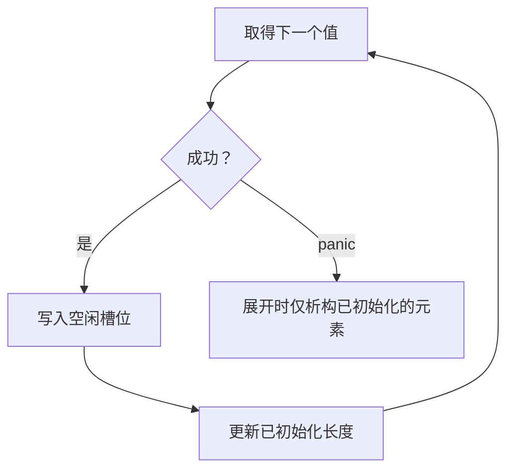

# 20.7 panic safety

批量添加元素时，`Clone` 或回调都可能 panic。对于使用裸指针或 `MaybeUninit` 的实现，**每成功写入一个元素，就把它计入已经初始化的范围**；不要在初始化前就把 `len` 设成最终值。



应用代码直接用 `push` 就能得到同样的保证，无需复刻标准库内部实现：

```rust
fn main() {
    use std::panic::catch_unwind;

    let outcome = catch_unwind(|| {
        let mut values = Vec::with_capacity(3);
        for i in 0..3 {
            assert_ne!(i, 2, "构造最后一个元素失败");
            values.push(i.to_string());
        }
    });
    assert!(outcome.is_err()); // 以 unwind 策略运行
}
```

第三个元素没有写入，前两个字符串在展开时由 `Vec` 析构。若使用 `panic = "abort"`，进程会直接终止，本示例不会走到最后的断言。
