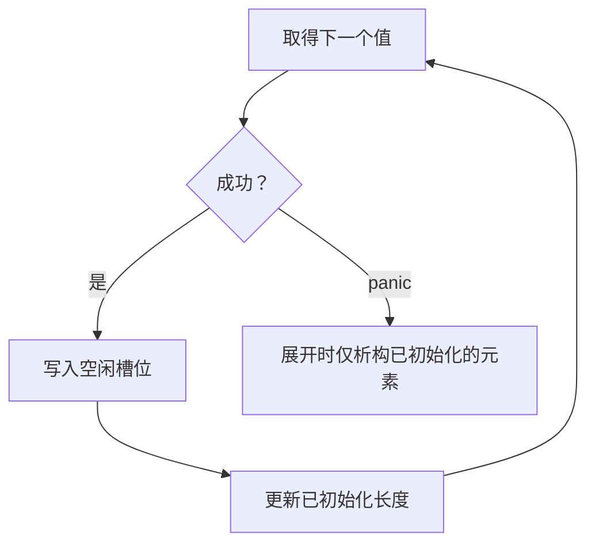

# 20.7 panic safety

在利用 unsafe 写库的时候，还需要注意的一点是“panic 安全”。panic 在什么情况下发生是难以预测的，我们要做的是，即便在发生 panic 的时候，也能保证“内存安全”。

`Vec::truncate` 保留前面的元素并删除尾部。最直观的实现是先析构尾部，最后才把 `len` 更新为截断后的长度。

可惜这么做是不对的。因为“对象的析构函数”是用户自定义的行为，在这个方法里面会执行什么逻辑是无法提前确定的。所以，我们应该假设它有可能发生 panic。如果有对象已经执行了析构，但是还继续把它留在数组里面，等待数组最后来重新设置长度，是有风险的。解决办法是先从逻辑上移除待析构的元素，再执行用户代码。Rust 1.100.0 的源码如下：

---

```text
    pub fn truncate(&mut self, len: usize) {
        // SAFETY: `BufWriter::flush_buf` assumes that this will not
        // de-initialize any elements of the spare capacity.

        // This is safe because:
        //
        // * the slice passed to `drop_in_place` is valid; the `len > self.len`
        //   case avoids creating an invalid slice, and
        // * the `len` of the vector is shrunk before calling `drop_in_place`,
        //   such that no value will be dropped twice in case `drop_in_place`
        //   were to panic once (if it panics twice, the program aborts).
        unsafe {
            // Note: It's intentional that this is `>` and not `>=`.
            //       Changing it to `>=` has negative performance
            //       implications in some cases. See #78884 for more.
            if len > self.len {
                return;
            }
            let remaining_len = self.len - len;
            let s = self.as_mut_ptr().add(len).cast_slice(remaining_len);
            self.len = len;
            ptr::drop_in_place(s);
        }
    }
```

---

注意 Rust 1.100.0 的实现先更新 `len`，再析构原尾部切片。因而即使尾部某个元素的析构发生 panic，`Vec` 也不会再把那些槽位视为它仍拥有的元素。

---

```text
    fn extend_with(&mut self, n: usize, value: T) {
        self.reserve(n);

        // ignore-tidy-undocumented-unsafe
        unsafe {
            let mut ptr = self.as_mut_ptr().add(self.len());
            // Use SetLenOnDrop to work around bug where compiler
            // might not realize the store through `ptr` through self.set_len()
            // don't alias.
            let mut local_len = SetLenOnDrop::new(&mut self.len);

            // Write all elements except the last one
            for _ in 1..n {
                ptr::write(ptr, value.clone());
                ptr = ptr.add(1);
                // Increment the length in every step in case clone() panics
                local_len.increment_len(1);
            }

            if n > 0 {
                // We can write the last element directly without cloning needlessly
                ptr::write(ptr, value);
                local_len.increment_len(1);
            }

            // len set by scope guard
        }
    }
```

---

这个方法是往 Vec 后面继续扩展 n 个元素，下面的内部函数从一个元素进行克隆，并在最后一步直接移动它。

`SetLenOnDrop` 保存当前已经初始化的长度，每次写入成功后才更新它。如果 `clone` 展开，守卫会把已完成的长度写回；如果顺利完成，无须克隆最后一个值，可以直接移动进去。

从上面的实现可以提炼出下面的状态转换：



如果直接使用 `Vec::push`，不用手写守卫也能遵守同样的顺序：

```rust
fn main() {
    use std::panic::catch_unwind;

    let outcome = catch_unwind(|| {
        let mut values = Vec::with_capacity(3);
        for i in 0..3 {
            assert_ne!(i, 2, "构造最后一个元素失败");
            values.push(i.to_string());
        }
    });
    assert!(outcome.is_err()); // 以 unwind 策略运行
}
```
