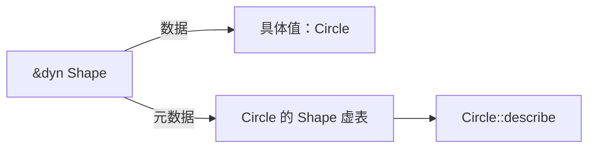

# 23.1 trait object

什么是 trait object 呢？
Trait object 是一种允许我们在运行时使用不同具体类型的实例的方式，前提是这些类型都实现了某个共同的 trait。
它通常通过指向 trait 的指针（如 `&dyn Trait` 或 `Box<dyn Trait>`）来实现动态分派。
`dyn Trait` 本身是一个动态大小类型（DST），意味着它的大小在编译时无法确定。因此，我们不能直接在栈上创建 `dyn Trait` 类型的变量，而是需要通过指针来间接操作。
例如，假如 `Bird` 是一个 trait 的名称，那么 `dyn Bird` 就是一个 DST。而 `&dyn Bird`、`&mut dyn Bird`、`Box<dyn Bird>`、`Rc<dyn Bird>` 等是指向 trait object 的指针类型。

示例：

```rust
trait Shape {
    fn area(&self) -> f64;
    fn describe(&self) -> String;
}

struct Circle {
    radius: f64,
}

impl Shape for Circle {
    fn area(&self) -> f64 {
        std::f64::consts::PI * self.radius * self.radius
    }
    fn describe(&self) -> String {
        format!("a circle with radius {}", self.radius)
    }
}

struct Square {
    side: f64,
}

impl Shape for Square {
    fn area(&self) -> f64 {
        self.side * self.side
    }
    fn describe(&self) -> String {
        format!("a square with side {}", self.side)
    }
}

// dyn Trait: 可以返回实现了 Shape trait 的不同具体类型
fn get_random_shape(is_circle: bool) -> Box<dyn Shape> {
    if is_circle {
        Box::new(Circle { radius: 1.0 })
    } else {
        Box::new(Square { side: 2.0 })
    }
}

// impl Trait: 必须返回一个单一的具体类型（尽管对调用者来说是不透明的）
// 以下函数总是返回 Circle 类型
fn get_a_circle() -> impl Shape {
    Circle { radius: 3.0 }
}

// 以下函数根据条件返回不同大小的 Square，但始终是 Square 类型
fn get_a_transformed_square(make_large: bool) -> impl Shape {
    if make_large {
        Square { side: 5.0 }
    } else {
        Square { side: 1.0 }
    }
}

fn main() {
    let shape1: Box<dyn Shape> = get_random_shape(true); // 实际值是 Circle
    let shape2: Box<dyn Shape> = get_random_shape(false); // 实际值是 Square

    println!("Shape 1 is {}, area: {:.2}", shape1.describe(), shape1.area());
    println!("Shape 2 is {}, area: {:.2}", shape2.describe(), shape2.area());

    // 使用 dyn Trait 存储异构集合
    let shapes: Vec<Box<dyn Shape>> = vec![
        Box::new(Circle { radius: 2.5 }),
        Box::new(Square { side: 3.5 }),
        get_random_shape(true), // 可能是 Circle
        get_random_shape(false), // 可能是 Square
    ];

    println!("\\nShapes in a vector (using dyn Trait):");
    for shape in shapes {
        println!(" - {}, area: {:.2}", shape.describe(), shape.area());
    }

    // 使用 impl Trait
    let specific_circle = get_a_circle(); // 类型是 impl Shape，实际是 Circle
    println!("\\nSpecific circle (using impl Trait) is {}, area: {:.2}", specific_circle.describe(), specific_circle.area());

    let small_square = get_a_transformed_square(false); // 类型是 impl Shape，实际是 Square
    println!("Transformed square (small) is {}, area: {:.2}", small_square.describe(), small_square.area());
    let large_square = get_a_transformed_square(true); // 类型是 impl Shape，实际是 Square
    println!("Transformed square (large) is {}, area: {:.2}", large_square.describe(), large_square.area());


}
```

示例代码中，我们定义了 `Shape` trait 和两个实现它的结构体 `Circle` 和 `Square`。然后我们有几个函数来演示 `dyn Trait` 和 `impl Trait` 的用法。

## 使用 `dyn Trait`：动态返回与异构集合

函数 `get_random_shape` 返回一个 `Box<dyn Shape>`。这意味着该函数可以返回任何实现了 `Shape` trait 的具体类型的实例，并将其包装在 `Box` 中。在示例中，根据传入的布尔值，它可能返回一个 `Circle` 或一个 `Square`。这种在运行时确定具体类型的能力是**动态分派**的核心。

此外，`main` 函数中还演示了如何创建一个 `Vec<Box<dyn Shape>>`。这是一个可以存储不同类型形状（只要它们都实现了 `Shape` trait）的异构集合。当我们遍历这个 vector 并调用如 `describe()` 或 `area()` 等方法时，实际调用的方法会根据每个元素在运行时的具体类型来确定。

## 使用 `impl Trait`：静态但匿名的返回类型

函数 `get_a_circle` 和 `get_a_transformed_square` 返回 `impl Shape`。这表明这些函数会返回某个实现了 `Shape` trait 的具体类型，但调用者不能直接使用未公开的具体类型，可以依赖签名声明的 `Shape` 约束（该类型对调用者是“不透明的”）。

关键在于，对于一个给定的 `impl Trait` 返回类型的函数，它必须总是返回 **_同一个_** 具体类型。
例如，`get_a_circle` 总是返回 `Circle`。`get_a_transformed_square` 函数虽然内部有条件逻辑（基于 `make_large` 参数），但它的所有执行路径都返回 `Square` 类型（只是实例的 `side` 属性可能不同）。如果一个函数尝试在不同的路径返回不同的具体类型（例如，一边返回 `Circle`，另一边返回 `Square`），则会导致编译错误。

这种方式允许库作者隐藏返回类型的具体细节，同时编译器仍然可以在编译时进行类型检查和优化（如通过单态化，monomorphization），因为返回的具体类型对编译器是已知的。这是**静态分派**的一种体现（对于函数体内部的调用而言，返回给调用者的是一个不透明类型）。

**核心区别与选择**

- **`dyn Trait`**：
  - 允许多态，即在运行时确定具体类型。
  - 适用于需要存储异构集合（例如 `Vec<Box<dyn MyTrait>>`）的场景。
  - 涉及胖指针和虚函数表（vtable）查找，有轻微的运行时开销。
- **`impl Trait`**：
  - 返回类型是某个确定的、但对调用者不透明的具体类型。
  - 编译器在编译期进行类型检查和单态化（monomorphization），通常性能更好。
  - 不适用于需要存储不同具体类型的集合。

## 数据指针与虚表

`&dyn Shape` 带有指向具体值的数据指针和指向虚函数表的元数据。调用 `describe()` 时，程序通过对应的虚表找到该具体类型的实现；对象本身不需要保存虚表指针。下面只画概念关系，虚表的布局及地址不属于稳定接口，不应通过 `transmute` 解析。



不是每个 trait 都能构造这样的对象；参见 [23.2 dyn 兼容性](./23.2%20object%20safe.md)。
