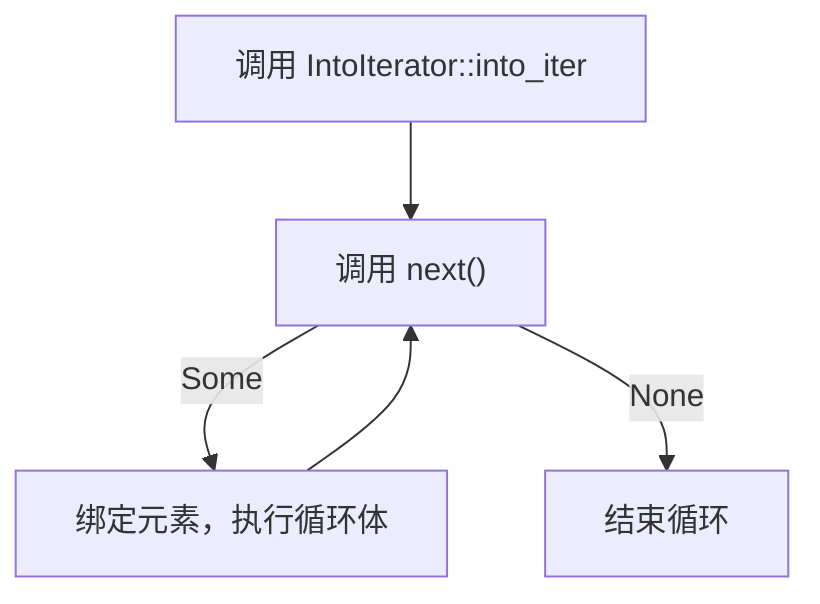

# 24.2 迭代器

迭代器是 Rust 的一项重要功能。Rust 的迭代器是指实现了 `Iterator` trait 的类型。这个 `Iterator` trait 的定义如下：

```rust
pub trait Iterator {
    type Item;

    fn next(&mut self) -> Option<Self::Item>;

    // 省略有默认实现的方法
}
```

它最主要的一个方法就是 `next()`，返回一个 `Option<Item>`。有下一个元素时返回 `Some(item)`，通常以 `None` 结束。只有 `FusedIterator`（或加了 `.fuse()` 的迭代器）保证第一次返回 `None` 后始终返回 `None`。

## 24.2.1 实现自定义迭代器

接下来我们试一下如何实现一个迭代器。假设我们的目标是，这个迭代器会生成一个从`1`到`100`的序列。我们需要创建一个类型，这里使用 struct，它要实现 `Iterator` trait。注意到每次调用 `next` 方法的时候，它都返回不同的值，所以它一定要有一个成员，能记录上次返回的是什么。完整代码如下：

```rust
use std::iter::Iterator;

struct Seq {
    current : i32
}

impl Seq {
    fn new() -> Self {
        Seq { current: 0 }
    }
}

impl Iterator for Seq {
    type Item = i32;

    fn next(&mut self) -> Option<i32> {
        if self.current < 100 {
            self.current += 1;
            return Some(self.current);
        } else {
            return None;
        }
    }
}

fn main() {
    let mut seq = Seq::new();
    while let Some(i) = seq.next() {
        println!("{}", i);
    }
}
```

编译执行，可见结果和预期一样。

## 24.2.2 迭代器的组合

Rust 标准库有一个命名规范，从容器创造出迭代器一般有三种方法：

* `iter()`创造一个 Item 是 `&T` 类型的迭代器；

* `iter_mut()`创造一个 Item 是 `&mut T` 类型的迭代器；

* `into_iter()`创造一个 Item 是 `T` 类型的迭代器。

比如，用 `Vec` 示例如下：

```rust
fn main() {
    let v = vec![1,2,3,4,5];
    let mut iter = v.iter();
    while let Some(i) = iter.next() {
        println!("{}", i);
    }
}
```

如果迭代器就是这么简单，那么它的用处基本就不大了。Rust 的迭代器有一个重要特点，那它就是可组合的（composability）。我们在前面演示的迭代器的定义，实际上省略了很大一部分内容，去官方文档去查一下，可以看到 `Iterator` trait 里面还有一大堆的方法，比如`map`、`filter`、`skip_while`、`take`等等，这些方法都有默认实现，它们可以统称为迭代器适配器（Iterator adaptors）。它们有个共性，返回的是一个具体类型，而这个类型本身也实现了 `Iterator` trait。这意味着，我们调用这些方法可以从一个迭代器创造出一个新的迭代器。

我们用示例来演示一下这些适配器的威力：

```rust
fn main() {
    let v = vec![1,2,3,4,5,6,7,8,9];
    let mut iter = v.iter()
        .take(5)
        .filter(|&x| x % 2 == 0)
        .map(|&x| x * x)
        .enumerate();
    while let Some((i, v)) = iter.next() {
        println!("{} {}", i, v);
    }
}
```

这种写法很有点“声明式”编程的味道。将多个调用链接到迭代器适配器，以可读的方式执行复杂的操作。适配器函数名本身就代表了用户的“意图”，它表达的重点是“我想做什么”，而不是具体怎么做。这个跟 C# 的 linq 很相似。

如果我们用传统的循环来写这些逻辑，这段代码类似下面这样：

```rust
fn main() {
    let v = vec![1,2,3,4,5,6,7,8,9];
    let mut iter = v.iter();
    let mut count = 0;
    let mut index = 0;

    while let Some(i) = iter.next() {
        if count < 5 {
            count += 1;
            if (*i) % 2 == 0 {
                let s = (*i) * (*i);
                println!("{} {}", index, s);
                index += 1;
            }
        } else {
            break;
        }
    }
}
```

上面这种写法，源代码更倾向于实现细节。两个版本相比较，迭代器的可读性是不言而喻的。这种抽象相比于直接在传统的循环内部写各种逻辑是有优势的，特别是在后文“并行”的章节中我们可以看到，如果我们想把迭代器改成并行执行是非常容易的事情。而传统的写法涉及细节太多，不太容易改成并行执行。
（一个题外话，迭代器的可组合性是一个非常大的优点，新版 C++ 标准中引入了 ranges 这个库，主要就是为了解决这个问题。）

通过上面分析迭代器的实现原理我们也可以知道：构造一个迭代器本身，是代价很小的行为，因为它只是初始化了一个对象，并不真正产生或消费数据。不论迭代器内部嵌套了多少层，最终消费数据还是要通过调用`next()`方法实现的。
这个特点，也被称为惰性求值（lazy evaluation）。也就是说，如果用户写了下面这样的代码：

```rust
let v = vec![1, 2, 3, 4, 5];
v.iter().map(|x| println!("{}", x));
```

实际上是什么事都没做。因为 `map` 方法只是把前面一个迭代器包装一下，通过实现的闭包，返回了一个新的迭代器而已，没有真正读取容器内部的数据。

由于所有迭代器都是惰性的，所以我们需要调用一个消费适配器方法来从所有的适配器调用中获取结果。例如对上面的代码进行修改：

```rust
let v1 = vec![1, 2, 3];
let v2: Vec<_> = v1.iter().map(|x| x + 1).collect();
assert_eq!(v2, vec![2, 3, 4]);
```

上例通过调用 `collect` 方法来消耗新迭代器，并返回一个新的 `Vec`。
类似还有 `sum` 方法，它获取迭代器的所有权，并通过重复调用 `next` 来迭代每个项，从而消耗迭代器。对这类在内部调用了 `next` 方法来消耗迭代器的方法，我们称之为消费方法（consuming methods）。

## 24.2.3 迭代器的性能
迭代器虽然是一个高级抽象，但编译后的代码与您自己手动编写的低级代码大致相同。迭代器是 Rust 的零成本抽象之一，我们的意思是使用抽象不会带来额外的运行时开销。现在你知道了这一点，你可以毫无畏惧地使用迭代器和闭包了！它们使代码看起来更高级，而且不会因此对运行时性能造成损失。

## 24.2.4 `for` 循环

在前面的示例中，我们都是手工直接调用迭代器的 `next()` 方法，然后使用 `while let` 语法来做循环。实际上，Rust 里面更简洁、更自然地使用迭代器的方式是使用 `for` 循环。本质上来说，`for` 循环就是专门为迭代器设计的一个语法糖。
`for` 接受实现了 `IntoIterator` 的值，例如数组、切片和 `Vec`。字符串本身没有实现 `IntoIterator`：按字符迭代用 `.chars()`，按字节迭代用 `.bytes()`。

```rust
use std::collections::HashMap;

fn main() {
    let v = vec![1,2,3,4,5,6,7,8,9];
    for i in v {
        println!("{}", i);
    }

    let map : HashMap<i32, char> =
        [(1, 'a'), (2, 'b'), (3, 'c')].iter().cloned().collect();
    for (k, v) in &map {
        println!("{} : {}", k, v);
    }
}
```

那么 `for` 循环是怎么做到这一点的呢？原因就是下面这个 trait：

```rust
trait IntoIterator {
    type Item;
    type IntoIter: Iterator<Item=Self::Item>;
    fn into_iter(self) -> Self::IntoIter;
}
```

只要某个类型实现了 IntoIterator，那么调用`into_iter()`方法就可以得到对应的迭代器。这个 `into_iter()` 方法的 receiver 是`self`，而不是`&self`，执行的是 move 语义。这么做，可以同时支持`Item`类型为`T`、`&T`或者`&mut T`，用户有选择的权力。

来看看常见的容器是怎样实现这个 trait 的就明白了：

下面是 `BTreeMap` 标准库实现的简化摘录，略去分配器参数和函数体：

```text
impl<K, V> IntoIterator for BTreeMap<K, V> {
    type Item = (K, V);
    type IntoIter = IntoIter<K, V>;
}
impl<'a, K: 'a, V: 'a> IntoIterator for &'a BTreeMap<K, V> {
    type Item = (&'a K, &'a V);
    type IntoIter = Iter<'a, K, V>;
}
impl<'a, K: 'a, V: 'a> IntoIterator for &'a mut BTreeMap<K, V> {
    type Item = (&'a K, &'a mut V);
    type IntoIter = IterMut<'a, K, V>;
}
```

对于一个容器类型，标准库里面对它 impl 了三次 `IntoIterator`。当 Self 类型为 `BTreeMap` 的时候，`Item` 类型为`(K, V)`，这意味着，每次 `next()` 方法都是把内部的元素 move 出来了；当 Self 类型为`&BTreeMap`的时候，`Item` 类型为`(&K, &V)`，每次 `next()` 方法返回的是借用；当 Self 类型为`&mut BTreeMap`的时候，`Item` 类型为`(&K, &mut V)`，每次`next()`方法返回的 `key` 是只读的，`value` 是可读写的。

所以，如果有个变量 `m`，其类型为 `BTreeMap`，那么用户可以选择使用 `m.into_iter()` 或者 `(&m).into_iter()` 或者 `(&mut m).into_iter()`，分别达到不同的目的。

| 传给 `for` 的值 | `BTreeMap<K, V>` 的元素类型 | 循环后的容器 |
| --- | --- | --- |
| `map` | `(K, V)` | 容器被消耗 |
| `&map` | `(&K, &V)` | 容器保留 |
| `&mut map` | `(&K, &mut V)` | 容器保留，可改值但不能经此引用改键 |

那么 `for` 循环和 `IntoIterator` trait 究竟是什么关系呢？下面我们写一个简单的 `for` 循环示例：

```rust
fn do_something(e : &i32) {}

fn main() {
    let array = &[1,2,3,4,5];

    for i in array {
        do_something(i);
    }
}
```

如需观察编译器的内部表示，可把示例存为 `test.rs`，使用 Nightly 的 `-Zunpretty`：

```shell
rustc +nightly --edition 2024 -Zunpretty=hir test.rs
```

下面是旧版 HIR 输出的摘录。它是编译器诊断工具的输出，不是要再次编译的 Rust 源码；新版的名称和内部表示可能不同。

```text
#[prelude_import]
use std::prelude::v1::*;
#[macro_use]
extern crate std as std;
fn do_something(e: &i32) { }

fn main() {
    let array = &[1, 2, 3, 4, 5];

    {
        let _result =
            match ::std::iter::IntoIterator::into_iter(array) {
                mut iter =>
                loop  {
                    let mut __next;
                    match ::std::iter::Iterator::next(&mut iter) {
                        ::std::option::Option::Some(val) =>
                        __next = val,
                        ::std::option::Option::None => break ,
                    }
                    let i = __next;
                    { do_something(i); }
                },
            };
        _result
    }
}
```

这说明 Rust 的 `for <item> in <container> { <body> }` 语法结构就是一个语法糖。这个语法的原理是通过 `IntoIterator::into_iter(container)`来获得迭代器，然后不断循环调用迭代器的 `next()` 方法，将返回值解包，赋值给 `<item>`，然后调用 `<body>`语句块。



图中省略了 `break`、`continue` 等提前控制流。下面分别演示可变借用、共享借用和消耗：

```rust
fn main() {
    let mut values = vec![1, 2];
    for value in &mut values {
        *value *= 2;
    }
    for value in &values {
        assert_eq!(*value % 2, 0);
    }
    let mut total = 0;
    for value in values {
        total += value;
    }
    assert_eq!(total, 6);
}
```

Rust 的 `IntoIterator` trait 实际上就是 `for` 语法的扩展接口。如果我们需要让各种自定义容器也能在 `for` 循环中使用，那就可以借鉴标准库中的写法，自行实现这个 trait 即可。
这跟其他语言的设计思路是一样的。比如：C# 的 foreach 语句也可以对自定义类型使用，它的扩展接口就是标准库中定义的 IEnumerable 接口；
Java 的 for 循环的扩展接口是标准库中的 Iterable 接口；
C++ 的 Range-based-for 循环也可以使用自定义容器，它约定的是调用容器的 `begin()/end()` 成员方法。
