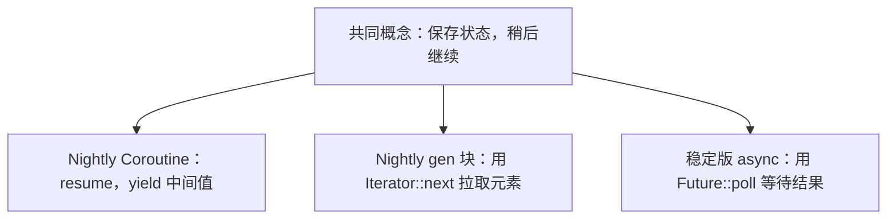

# 25.1 简介

协程很像前面讲过的闭包，也能捕获外部变量。普通闭包会运行至返回；Nightly 的 `#[coroutine]` 闭包则能在 `yield` 处暂停，下一次恢复时继续。

## 25.1.1 `yield` 关键字

yield 是这一切的基石，你可以把它想象成函数里的一个**“可恢复的暂停按钮”** 或 “书签”。当代码执行到 yield 时，它会：

1. 交出（Yield）一个值：把 yield 后面的值作为结果返回给调用者。

2. 暂停（Pause）执行：将函数的当前状态（包括执行位置和恢复后还要用到的局部变量）保存下来，暂时挂起。

3. 交还（Yield）控制权：将程序的控制权返回给调用它的地方。

当调用者下一次“唤醒”（resume）这个协程时，它会精确地从上次 yield 暂停的地方继续执行，恢复所需的局部变量保留原来的值。

## 协程 与 yield

协程是实现了 yield 机制的、最通用的底层结构。

- 它的定义：一个可以被暂停、恢复，并在暂停/恢复之间传递数据的计算单元。

- 它的本质：一个**双向通道**。

    1. 向外：通过 `yield` 将值产出给调用者。

    2. 向内：通过 `resume(argument)` 方法，在被唤醒时可以从调用者那里接收一个值。

**在 Rust 中，编译器把带有 `#[coroutine]` 的协程闭包转换为实现 `Coroutine` 的状态机。**

下面用 `Coroutine` 演示双向传值，需要 Nightly 的 `coroutines`、`coroutine_trait` 和 `stmt_expr_attributes`：

```rust:{channel:"nightly",edition:"2024"}
#![feature(stmt_expr_attributes, coroutines, coroutine_trait)]

use std::ops::{Coroutine, CoroutineState};
use std::pin::pin;

fn main() {
    let mut my_coroutine = pin!(#[coroutine] |initial: i32| {
        let from_caller = yield initial + 1;
        from_caller * 2
    });

    assert!(matches!(my_coroutine.as_mut().resume(0), CoroutineState::Yielded(1)));
    assert!(matches!(my_coroutine.as_mut().resume(21), CoroutineState::Complete(42)));
}
```

> `#[coroutine]` 不能省略：编译器不允许在普通闭包中使用 `yield`。第一次 `resume` 的参数是 `initial`，第二次的参数才是 `yield` 表达式的值。

目前协程（coroutines）基础已经在 Nightly 里有原型（例如 `#[coroutine]`），[相关 tracking issue](https://github.com/rust-lang/rust/issues/43122) 上一直在跟进。

你可以将 Coroutine 视为一个通用的“引擎”。 它提供了暂停、恢复、双向通信的核心能力，但它本身不限定具体用途。它既可以用来生产数据，也可以用来协调任务。

## 25.1.2 生成器（Generator）

生成器是一个专门用于**惰性地、按需地生成一个值序列**的协程。它主要利用了协程的**向外**产出（yield）能力。它就像一个序列的生产者。在概念上，生成器是协程的一种常见用途；Rust 中这两个实验接口并不相同。

在很多语言（如 Python）中，yield 关键字创建的直接就是“生成器”，因为这是最常见的用例。在很早以前（2018年前后），Rust Nightly 有过 `move || { yield ... }` 这样的 generator 语法，能跟 `std::ops::Generator` 一起用。

现在，Rust 的 `gen` 块生成的是 `Iterator`；调用方用 `next` 取得元素，不必显式传恢复参数，也不处理独立的完成值。

::: tip 新版变化
Edition 2024 保留了 `gen` 关键字，但 `gen` 块仍需 Nightly 的 `gen_blocks` 实验特性。可以把它想成用直接的循环代码写出一个迭代器。下面以 Fibonacci 数列为例：
:::

```rust:{channel:"nightly",edition:"2024"}
#![feature(gen_blocks)]

fn fib() -> impl Iterator<Item = usize> {
    // gen block 返回一个 impl Iterator 的匿名类型。
    gen {
        let mut n1 = 1;
        let mut n2 = 1;
        let mut n3 = 2;
        yield n1;
        yield n2;
        loop {
            yield n3;
            n1 = n2;
            n2 = n3;
            n3 = n1 + n2;
        }
    }
}

fn main() {
    // 通过 take 截断前 10 个值。
    println!("{:?}", fib().take(10).collect::<Vec<usize>>());
}
```

若要在 Cargo 项目中运行，将 `Cargo.toml` 的 `edition` 设为 `"2024"`，然后执行 `cargo +nightly run`；无需旧的 `cargo-features` 或 `RUSTFLAGS`。

这个生成器会把循环状态保留到下一次 `next()`。稳定版可用 `std::iter::from_fn` 表达相同的惰性迭代（见本节结尾）；普通 `from_fn` 闭包不能直接使用 `yield`。

`gen` 块也能捕获外部变量。下面同样需要 Nightly 的 `gen_blocks`；用 `move` 把倍数和切片引用按值捕获，引用的生命周期仍绑定在输入切片上：
```rust:{channel:"nightly",edition:"2024"}
#![feature(gen_blocks)]

// gen block 引用 `input`，因此返回值类型添加生命周期 `'_` 进行约束
fn gen_multiple(input: &[usize], multiple: usize) -> impl Iterator<Item = usize> + '_ {
    // 将 `multiple` move 进 gen block，否则以 `&usize` 的形式访问 `multiple`
    gen move {
        for i in input {
            yield i * multiple;
        }
    }
}

fn main() {
    let input = (0..10).collect::<Vec<usize>>();
    println!("{:?}", gen_multiple(&input, 2).collect::<Vec<usize>>());
}
```

设计讨论还用异步生成器说明如何把“等待”和“产出”组合起来。下面只保留概念性伪代码；`async gen` 与所写的接口不是 Rust 1.100 稳定版 API：

```text
async gen {
  while let Some(item) = inner.next().await {
    yield func(item).await;
  }
}

// 按照设想，应该解糖为:
std::stream::from_fn(|ctx| {
  while let Some(item) = await_with!(inner.next(), ctx) {
    yield Ready(Some(await_with!(func(item), ctx)));
  }
  Ready(None)
})
```

> 这部分内容来自 [Rust: Generator 已死，Coroutine 当立，Generator 又活了](https://nihil.cc/posts/rust_coroutine/)

## `await` 与 `yield`

你可能会想：“我用的是稳定版 Rust，从来没写过 yield，但这听起来很像 async/await 啊？”

两者都可以用可暂停的状态机来理解。不过 `.await` 不等同于调用公开的 `Coroutine` 或直接写 `yield`：它轮询内部 Future，只有未就绪时才暂停当前异步逻辑。

```rust
// 用本地数据模拟下载，避免引入网络依赖。
async fn download_file() -> Vec<u8> { vec![1, 2, 3] }

async fn do_stuff() {
    println!("准备下载...");
    let data = download_file().await; // 这里的 .await
    println!("下载完成: {:?}", data);
}
```

编译器在背后做的事情，概念上等同于：

1. `do_stuff` 创建一个实现 `Future` 的状态机。

2. `download_file()` 返回一个 Future。

3. `.await` 推进内部 Future，必要时暂停。

  - **暂停**：如果下载 Future 返回 `Pending`，外层 Future 也返回 `Pending`，把控制权交回执行器。

  - **等待**：下载操作可能取得进展时，通过当前任务的 `Waker` 通知执行器。

  - **恢复**：执行器重新轮询外层 Future，外层继续轮询 `download_file()`。内层返回 `Ready` 后，结果才赋给 `data`。

因此，稳定版不需要写 `yield` 就能表达异步的暂停与恢复。

**关系图**



## 25.1.3 生成 Fibonacci 数列

我们可以用协程生成一个 Fibonacci 数列：

下面的协程版仍需 Nightly 的 `coroutines`、`coroutine_trait` 和 `stmt_expr_attributes`。

```rust:{channel:"nightly",edition:"2024"}
// 方案一
#![feature(stmt_expr_attributes, coroutines, coroutine_trait)]

use std::ops::{Coroutine, CoroutineState};
use std::pin::Pin;

fn main() {
    // 新版 coroutine 写法
    let mut g = #[coroutine] || {
        let (mut curr, mut next) = (Some(1_u64), Some(1_u64));
        while let Some(value) = curr {
            yield value;
            curr = next;
            next = next.and_then(|n| value.checked_add(n));
        }
    };

    let mut pinned = Pin::new(&mut g); // 必须 Pin

    loop {
        // resume 现在的 arg 类型是 ()，得传单位参数
        match Coroutine::resume(pinned.as_mut(), ()) {
            CoroutineState::Yielded(v) => println!("{}", v),
            CoroutineState::Complete(_) => break,
        }
    }
}
```

协程最大的特点就是，程序的执行流程可以在协程和调用者之间来回切换。当我们需要暂时从协程中返回的时候，就使用 `yield` 关键字；当调用者希望再次进入协程的时候，就调用 `resume()` 方法，这时程序执行的流程是从上次 yield 返回的那个点继续执行。

上述程序的执行流程很有意思，它是这样的：

* `let g = #[coroutine] || {...yield...};`这句话是初始化了一个局部变量，它是一个协程，此时并不执行协程内部的代码；

* 调用`Coroutine::resume()`方法，此时会调用协程内部的代码；

* 执行到`yield value;`这条语时，`value` 变量的值为 `1`，协程的方法此时会退出，`Coroutine::resume()`方法的返回值是`CoroutineState::Yielded(1)`，在 `main` 函数中，程序会打印出 `1`；

* 循环调用 `Coroutine::resume()` 方法，此时再次进入到协程内部的代码中；

* 此时协程会直接从上次退出的那个地方继续执行，更新 `curr` 和 `next`，进入下一次循环，然后再到 `yield value;` 这条语句返回；

* 如此循环往复，一直到所有可表示的项都已产出，循环结束，协程返回，此时`main`函数那边会匹配上`CoroutineState::Complete`这个分支，程序返回，执行完毕。

### 稳定版：同样按需产生序列

在稳定版可以用 `std::iter::from_fn`。下面的闭包保存相邻两项，调用一次就返回一项。`checked_add` 处理溢出，仍返回最后一个能用 `u64` 表示的项。

```rust
fn fibonacci() -> impl Iterator<Item = u64> {
    let (mut current, mut next) = (Some(1_u64), Some(1_u64));
    std::iter::from_fn(move || {
        let value = current?;
        current = next;
        next = next.and_then(|n| value.checked_add(n));
        Some(value)
    })
}

fn main() {
    assert_eq!(fibonacci().take(6).collect::<Vec<_>>(), [1, 1, 2, 3, 5, 8]);
}
```
