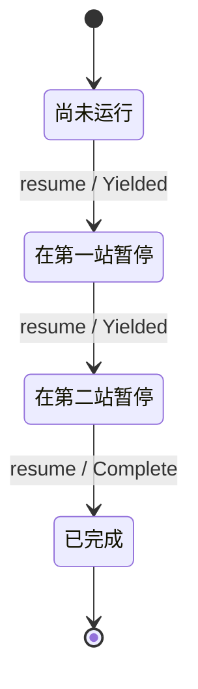

# 25.4 协程（Coroutine）

一个协程包含若干暂停点。每次调用 `resume`，它从当前状态执行到下一个 `yield` 或返回点。完成后不要再次恢复，具体行为由实现决定，编译器生成的协程会 panic。

下面的例子需要 Nightly 的 `coroutines`（协程语法）、`coroutine_trait`（公共接口）和 `stmt_expr_attributes`（在闭包表达式上写 `#[coroutine]`）。

```rust:{channel:"nightly",edition:"2024"}
#![feature(stmt_expr_attributes, coroutines, coroutine_trait)]

use std::ops::{Coroutine, CoroutineState};
use std::pin::pin;

fn main() {
    let mut trip = pin!(#[coroutine] || {
        yield "第一站";
        yield "第二站";
        "抵达终点"
    });

    assert!(matches!(trip.as_mut().resume(()), CoroutineState::Yielded("第一站")));
    assert!(matches!(trip.as_mut().resume(()), CoroutineState::Yielded("第二站")));
    assert!(matches!(trip.as_mut().resume(()), CoroutineState::Complete("抵达终点")));
}
```



## 状态机记住什么

编译器生成的状态机保存当前位置，以及暂停之后还要用到的局部变量。没有跨暂停点存活的变量无需留在状态里。可以用一个枚举想象上例的四个状态，但枚举只是解释模型，不代表实际的内存布局。

## 为什么使用 Pin

协程可能让一个局部变量引用另一个局部变量，并把两者都保留到下一次恢复。如果直接移动这种状态，内部引用可能仍然指向原地址。

因此 `resume` 接收 `Pin<&mut Self>`。对不实现 `Unpin` 的值，安全 Rust 不能通过这个已固定的引用移出值。上例用 `pin!` 在当前作用域内固定它；需要可持有所有权的固定指针时可用 `Box::pin`。移动指针本身不等于移动它指向的值。

更多说明见 [Unstable Book：coroutines](https://doc.rust-lang.org/unstable-book/language-features/coroutines.html)与 [标准库：Pin](https://doc.rust-lang.org/std/pin/)。
