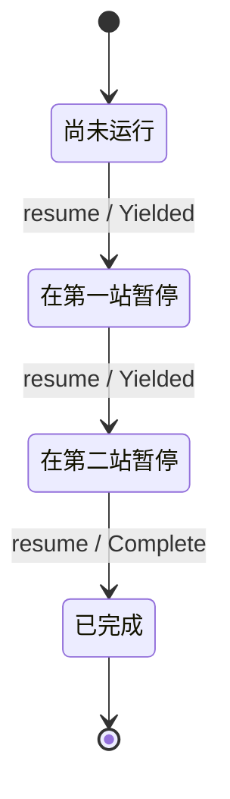

# 25.4 **Rust 异步的基石：协程（Coroutine）**

理解 `async/await` 时，可以先从 **协程（Coroutine）** 这种可暂停、可恢复的计算方式入手。

你可以把协程想象成厨房里那个“高效厨师”的工作流程。协程可以由用户代码协作式地恢复和调度；并发不等于并行，是否能在多个核上运行由执行环境决定。协程的实现方案一般可以分为 stackful 和 stackless 两种，Rust 的协程采用 stackless 的设计，不为每个协程保留独立调用栈。

> * **用户态**：协程不等同于操作系统线程，管理大量任务通常无需为每个任务分配一个线程和栈。
> *   **协作式**：意味着一个任务（比如“烧水”）必须主动“让出”CPU（比如在等待水开时），其他任务（比如“切菜”）才能运行。它不像线程那样由操作系统强制切换（抢占式）。

这一机制使 Rust 能**在单线程中管理大量异步任务**：任务暂停时不独占执行线程，唤醒时凭借状态恢复继续执行，从而实现高效的非阻塞编程。

> 因为 协程 本身仍是实验性特性，所以你需要使用 Nightly Rust 来运行本章节的代码。

## 第一步：什么是协程？

**前置知识**：了解普通函数如何一次性执行完毕，以及 `Iterator` 如何一次产出一个值。

协程就像一列观光列车，它可以在任何一个指定的“景点”站（`yield` 点）暂停，当你再次呼唤它时，它会从上次暂停的站点继续出发。

> **专业术语：协程（Coroutine）**
>
> **白话解释**：一个可以**被暂停和恢复**的特殊代码块。它能使用 `yield` 关键字“产出”一个值并暂停自己，等待下一次被唤醒。与旧的 `Generator` 概念相比，`Coroutine` 的设计更加通用。

下面摘录标准库中 `Coroutine` trait 的定义。`#[lang]` 和 `#[unstable]` 是标准库内部属性，不应复制到普通 crate 中：

```text
// library/core/src/ops/coroutine.rs
/// [RFC 2033]: https://github.com/rust-lang/rfcs/pull/2033
/// [unstable book]: ../../unstable-book/language-features/coroutines.html
#[lang = "coroutine"]
#[unstable(feature = "coroutine_trait", issue = "43122")]
#[fundamental]
#[must_use = "coroutines are lazy and do nothing unless resumed"]
pub trait Coroutine<R = ()> {
    type Yield;
    type Return;

    #[lang = "coroutine_resume"]
    fn resume(self: Pin<&mut Self>, arg: R) -> CoroutineState<Self::Yield, Self::Return>;
}
```

### **一个简单的协程示例**

以下协程闭包需要 Nightly 的 `coroutines`、`coroutine_trait` 和 `stmt_expr_attributes`。示例中的 `()` 表示调用方没有额外的恢复参数。

```rust:{channel:"nightly",edition:"2024"}
// main.rs
#![feature(stmt_expr_attributes, coroutines, coroutine_trait)] // 开启最新的协程特性

use std::ops::{Coroutine, CoroutineState};
use std::pin::Pin;

fn main() {
    // 创建一个协程闭包
    // 注意：现在它被称为 coroutine
    let mut coroutine = #[coroutine] || {
        println!("观光列车出发！");
        yield 1; // 在第一个景点暂停，产出值 1
        println!("前往下一个景点...");
        yield 2; // 在第二个景点暂停，产出值 2
        println!("旅途结束！");
        // Coroutine 没有显式的 return，最后一个表达式的值就是返回值
        "终点站纪念品"
    };

    // 唤醒协程。我们用 Pin 包裹它，并调用 resume。
    // resume 可以接受一个参数，这里我们传入 ()
    match Pin::new(&mut coroutine).resume(()) {
        CoroutineState::Yielded(value) => {
            println!("在景点 {} 下车游玩", value);
        }
        _ => panic!("出错了"),
    }

    // 再次唤醒
    match Pin::new(&mut coroutine).resume(()) {
        CoroutineState::Yielded(value) => {
            println!("在景点 {} 下车游玩", value);
        }
        _ => panic!("出错了"),
    }

    // 最后一次唤醒
    match Pin::new(&mut coroutine).resume(()) {
        CoroutineState::Complete(retval) => {
            println!("收到最终纪念品: {}", retval);
        }
        _ => panic!("出错了"),
    }
}
```

**输出：**
```text
观光列车出发！
在景点 1 下车游玩
前往下一个景点...
在景点 2 下车游玩
旅途结束！
收到最终纪念品: 终点站纪念品
```

`Coroutine::resume` 现在可以接受一个参数，这使得协程之间的双向通信成为可能；本例没有传递数据，参数为 `()`。双向传值见 [25.1](./25.1%20基础简介.md)。



协程返回 `Complete` 后不要再次恢复。编译器生成的协程此时会 panic。

## 第二步：协程如何“记忆”？

生成器是如何记住上次执行到哪儿，以及所有局部变量的值的？

一句话总结：**编译器将你的生成器代码，自动转换成了一个“状态机（State Machine）”对象。**

> **专业术语：状态机（State Machine）**
>
> **白话解释**：一个能够记住自己当前“状态”的对象。对于生成器来说，“状态”包括两个方面：
> 1.  **执行到哪了**：是在第一个 `yield` 之前，还是在第一个和第二个 `yield` 之间？
> 2.  **变量的值是多少**：在暂停时，所有需要跨越 `yield` 使用的局部变量的值都需要被保存下来。

让我们看一个经典的斐波那契例子。下面是协程体的伪代码，只为圈出跨越暂停点的局部变量；完整可运行的版本见 25.1：

```text
let mut fib = || {
    let mut current = 0; // 需要跨越 yield
    let mut next = 1;    // 需要跨越 yield

    loop {
        // `new_next` 只在单次循环内有效，不需要跨越 yield
        let new_next = current + next;
        current = next;
        next = new_next;
        yield current; // 暂停点
    }
};
```

编译器分析后会得出结论：
*   `current` 和 `next` 的值在每次 `yield` 之后，下一次 `resume` 时还需要使用，所以它们必须被提升为状态机结构体的**成员变量**。
*   `new_next` 在每次循环开始时创建，在 `yield` 之前就完成了它的使命，所以它只是 `resume` 方法内部的一个**普通局部变量**，不需要被保存。

### **深入底层：一个手工模拟的状态机**

假设我们有这样的协程逻辑（伪代码）：

```text
let mut coroutine = #[coroutine] || {
    let mut x = 10;
    yield x;
    x += 1;
    yield x;
};
```

下面是等价行为的手写状态机，而不是编译器的实际布局；它用到了 Nightly 的 `coroutine_trait`。注意在第二次 `yield` 后，还需一次 `resume` 才会得到 `Complete`：

```rust:{channel:"nightly",edition:"2024"}
#![feature(coroutine_trait)]

use std::ops::{Coroutine, CoroutineState};
use std::pin::Pin;

// 状态机用一个 enum 来表示当前进行到哪一步
enum MyCoroutineState {
    // 初始状态，保存着需要跨越 yield 的变量 x
    Start { x: i32 },
    // 第一次 yield 后的状态，同样保存着 x
    Yielded1 { x: i32 },
    // 第二次 yield 后，下一步才完成。
    Yielded2,
    Done,
}

// 整个协程就是一个包裹了状态的结构体
struct MyCoroutine {
    state: MyCoroutineState,
}

impl Coroutine for MyCoroutine {
    type Yield = i32;
    type Return = (); // 协程最后没有返回值

    fn resume(mut self: Pin<&mut Self>, _arg: ()) -> CoroutineState<i32, ()> {
        // 使用 mem::replace 可以安全地取出当前状态并留下一个占位符，
        // 避免在匹配期间对 self 的可变借用冲突。
        let current_state = std::mem::replace(&mut self.state, MyCoroutineState::Done);

        match current_state {
            // 1. 如果是初始状态
            MyCoroutineState::Start { x } => {
                println!("第一次唤醒，从头开始");
                // 更新下一次的状态为 Yielded1，并保存更新后的 x
                self.state = MyCoroutineState::Yielded1 { x: x };
                // 产出值并暂停
                return CoroutineState::Yielded(x);
            }
            // 2. 如果是第一次 yield 后的状态
            MyCoroutineState::Yielded1 { mut x } => {
                println!("第二次唤醒，从上个 yield 点继续");
                x += 1;
                self.state = MyCoroutineState::Yielded2;
                // 产出值并暂停
                return CoroutineState::Yielded(x);
            }
            MyCoroutineState::Yielded2 => CoroutineState::Complete(()),
            // 3. 如果已经完成
            MyCoroutineState::Done => {
                println!("协程已完成，再次唤醒会 panic");
                panic!("Coroutine resumed after completion");
            }
        }
    }
}

fn main() {
    let mut state_machine = MyCoroutine { state: MyCoroutineState::Start { x: 10 } };
    let mut coroutine = Pin::new(&mut state_machine);
    assert!(matches!(coroutine.as_mut().resume(()), CoroutineState::Yielded(10)));
    assert!(matches!(coroutine.as_mut().resume(()), CoroutineState::Yielded(11)));
    assert!(matches!(coroutine.as_mut().resume(()), CoroutineState::Complete(())));
}
```

手工模拟展示了：
1. **编译转换**：编译器将协程转换为状态机结构体，例如 `MyCoroutine`。
2. **状态转移**：通过枚举 `enum` 中的不同变体来记录执行阶段（如初始、第一次 yield 后、完成等）。
3. **数据保存**：需要记忆的变量（`x`）被存储在 `enum` 变体的字段中。
4. **恢复执行**：`resume` 方法通过 `match` 当前枚举状态，恢复变量值并跳转到正确的代码逻辑继续执行，实现 “未变变量继续可用” 的承诺。

### 第三步（进阶）：自引用问题

协程可能在暂停时保留对自身局部变量的借用。不能让这样一个协程在暂停后随意移动；然而 Nightly 可以用 `static` 协程闭包表达这种情况，必须先固定它，再恢复执行。这里仍需要 `coroutines`、`coroutine_trait` 和 `stmt_expr_attributes`：

```rust:{channel:"nightly",edition:"2024"}
#![feature(stmt_expr_attributes, coroutines, coroutine_trait)]

use std::ops::{Coroutine, CoroutineState};
use std::pin::pin;

fn main() {
    let mut coroutine = pin!(#[coroutine] static || {
        let local = [1, 2, 3];
        let ptr = &local[0];
        yield ();
        assert_eq!(*ptr, 1);
    });
    assert!(matches!(coroutine.as_mut().resume(()), CoroutineState::Yielded(())));
    assert!(matches!(coroutine.as_mut().resume(()), CoroutineState::Complete(())));
}
```

**为什么需要固定？**
因为编译器生成的状态机是**自引用**的：

```text
// 概念上的结构体，不是可直接构造的自引用类型
struct SelfRefCoroutine<'a> {
    local: [i32; 3],
    // ptr 指向了同一个结构体内的 local，'a 必须等于'self
    ptr: &'a i32,
    state: i32,
}
```

`ptr` 这个字段是一个引用，它指向了**同一个结构体内部**的 `local` 字段。这种结构被称为 **“自引用结构体” (Self-Referential Struct)**。

### **为什么自引用是危险的**

Rust 的一个基本假设是：**任何值默认都是可以被移动（Move）的**。移动操作在 Rust 中非常常见且廉价（通常只是内存拷贝）。
举个例子，大家还记得 `std::mem::swap` 方法吗？

```text
pub const fn swap<T>(x: &mut T, y: &mut T)
```

对于任意两个 T 类型的对象，如果我们拥有指向它们的 `&mut T` 型指针，就可以把它们互换位置。这个操作就相当于把这两个对象都 move 到了其他地方。如果这两个对象存在自引用的现象，那么这个 `swap` 操作就可以造成它们内部出现野指针。

1.  **初始状态**：`SelfRefCoroutine` 对象位于内存地址 `0x1000`。它的 `local` 字段在 `0x1000`，`ptr` 字段存储的地址也是 `0x1000`。一切正常。
2.  **移动对象**：现在，我们将整个对象移动到一个新的内存位置，比如 `0x2000`（这可能在函数返回、集合扩容等情况下发生）。
3.  **灾难发生**：
    *   `local` 字段的数据被拷贝到了新地址 `0x2000`。
    *   但是 `ptr` 字段里存储的地址值 `0x1000` 也被原封不动地拷贝了过去！
    *   现在，`ptr` 依然指向旧的、已经被释放或无效的内存地址 `0x1000`。它成了一个**悬垂指针（Dangling Pointer）**。
    *   当代码恢复执行，试图解引用 `*ptr` 时，便可能触发未定义行为；不能假定程序一定会崩溃。

安全 Rust 不允许用一个普通可移动结构体直接表达这样的自借用。由编译器生成的不可移动协程配合 `Pin` 可以保留这个内部借用。

## **第四步：解决方案 `Pin` —— 精准的“固定”**

既然问题出在“移动”上，那如果不让它移动，不就安全了吗？这就是 `Pin` 的作用。

### **`Pin` 的设计思想**

新建的异步状态机在尚未执行到建立自引用的位置前可以移动。例如，创建 Future 后，调用者可以把它交给执行器，再由执行器固定它。

对跨越暂停点的自引用而言，危险发生在借用已经建立、状态机却仍被移动的时候。`poll` 和 `resume` 要求先固定，是为了从第一次执行起就遵守这个约束。

所以，`Pin` 的作用可以更精确地描述为：
> **对不实现 `Unpin` 的值，`Pin` 约定该值在固定后到析构前不得被移出原地址。** 移动 `Pin<Box<T>>` 这样的指针本身不等于移动其所指的值。

`Future::poll` 和 `Coroutine::resume` 的 `self` 参数被设计为 `Pin<&mut Self>`，就是强制执行了这个契约：
*   你不能直接调用 `my_future.poll()`。
*   你必须先把它 `Pin` 住，然后才能通过 `Pin` 后的引用去调用 `poll`。
*   对 `!Unpin` 的 Future，不能通过安全接口把已固定的值移出；`Unpin` 的值不受该限制。

这个设计巧妙地平衡了灵活性（创建时可移动）和安全性（运行时不可移动），并且使得 `poll` 和 `resume` 方法的 API 本身可以是**安全**的（即方法签名上不需要 `unsafe` 关键字），因为 `Pin` 类型已经从类型系统层面提供了安全保证。

**这是 Rust 内存安全与零成本抽象哲学的完美体现。** `Pin` 的存在，就是为了让协程（以及其上的 `async/await`）这种包含自引用的高级抽象能够安全地运作。

## **总结：`async/await`、协程与 `Future` 的完整关系链**

可以把 `async` 生成的 Future 想象成上述状态机，但不必把编译器内部表示当成公开约定。

1. 调用 `async fn` 会创建一个实现 `Future` 的匿名状态机，还没有执行函数体。
2. 某处 `.await` 遇到内层 Future 返回 `Pending` 时，外层状态机保存恢复所需的状态，把控制权交回执行器。
3. `Pin` 保护固定后可能存在的内部引用；下一次 `poll` 会推进状态机，直到再次暂停或给出 `Ready`。
4. 这些行为依赖的是稳定的 `Future` 接口，不要求用户启用实验性的公共 `Coroutine` trait。两种接口的对照见 [25.6](./25.6%20Coroutine%20与%20Future.md)。

### 参考资料：
- [Rust coroutines RFC](https://github.com/rust-lang/rfcs/blob/master/text/2033-experimental-coroutines.md)
- [Rust nightly release notes](https://blog.rust-lang.org/nightly.html)
- [Rust pin 机制官方文档](https://doc.rust-lang.org/std/pin/index.html)
