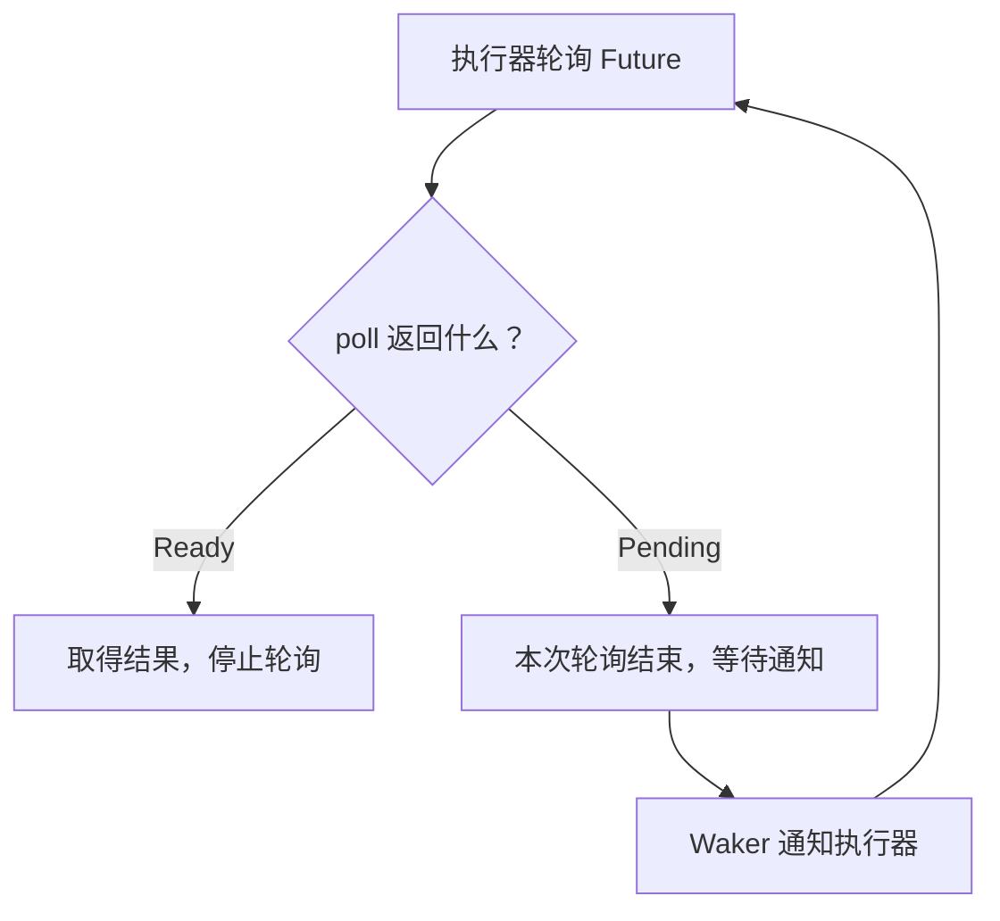

# 25.5 异步编程

async 和 await 关键字是目前许多语言都采用的主流方案，使用关键字而不是用宏来做 API，有助于社区的统一性，避免不同的异步方案使用完全不一样的用户 API。

在 Rust 语言和标准库中，只有极少数必须的关键字、trait 和类型，这体现了 Rust 的一个设计取舍：语言和标准库给出稳定基础，执行器和 I/O 运行时可以在库中独立演进。

从上一章节我们知道，Rust 的异步编程模型基于 Future 机制（`async` 由编译器转换成实现 `Future` 的状态机），而 async/await 语法糖让异步代码看起来像是同步的。

## 25.5.1 核心构件 `Future`

Future 是一个 Trait，Future 可以组合，一个 Future 可以由其他的一个或者多个 Future 包装而成。跟我们已经见过的迭代器 Iterator 很像。

其简化定义如下（将标准库内部路径改为公共路径，便于单独阅读）：

```rust
// 根据 library/core/src/future/future.rs 简化
use std::pin::Pin;
use std::task::{Context, Poll};

pub trait Future {
    // 这就是“凭证”未来能兑换的“商品”类型
    type Output;

    // “轮询”一下，看看“商品”到货了没
    fn poll(self: Pin<&mut Self>, cx: &mut Context<'_>) -> Poll<Self::Output>;
}
```

这里有两个关键点：

1.  **`Output` 类型**：定义了这个 `Future` 完成后会返回什么类型的值。比如，一个网络请求的 `Future`，其 `Output` 可能是一个 `String` 或 `Vec<u8>`。

2.  **`poll` 方法**：这是 `Future` 的心脏。它的作用就是去“问一下”：“我的任务完成了吗？” `poll` 方法的返回值 `Poll<T>` 是一个枚举：
    ```rust
    pub enum Poll<T> {
        Ready(T),
        Pending,
    }
    ```

    想象一下，你不断地去问餐厅前台：“我的外卖好了吗？”

    ```text
    你  -> poll() -> 前台
                      |
                      +--> "还没好呢！" (返回 Poll::Pending)
                      |
                      +--> "好了，给你！" (返回 Poll::Ready(你的外卖))
    ```

但是我们不断使用 `poll` 来查询状态，效率太低了。你告诉前台：“我的外卖好了，请打电话通知我。” 这个“电话号码”就是 **`Waker`**。

`poll` 方法的参数 `cx: &mut Context<'_>` 就包含了这个 `Waker`。

*   当一个 `Future` 的 `poll` 方法被调用，发现任务还没准备好（例如，网络数据还没到），它会返回 `Poll::Pending`。
*   在返回之前，需要时把最新的 `Waker` 注册给负责等待的部分；如果只是包装另一个 Future，也可以由内层完成注册。
*   当底层事件完成时（例如，操作系统通知网络数据已到达），它会调用 `Waker` 的 `wake()` 方法。
*   这个 `wake()` 调用就像是给执行器（Executor，下一节讲）打了个电话：“嘿，那个任务现在有进展了，快再来 `poll` 它一次吧！”

我们有了可以被暂停和唤醒的任务（`Future`），但谁来管理和驱动它们呢？答案是 **`Executor`（调度器/执行器）**，通常是 **`Runtime`（运行时）** 的一部分。它的具体实现可以由第三方库来实现。`Executor` 就像是厨房中统筹全局的厨师长。他手里有一份“任务清单”（一堆 `Future`s），他会轮询当前可运行的任务，推动它们向前执行。

**一个 `Executor` 的基本工作流程：**

1.  **接收任务**：你将一个顶层的 `Future` 交给 `Executor`。
2.  **事件循环**：`Executor` 启动一个循环，从任务队列中取出一个任务。
3.  **驱动任务**：调用任务的 `poll` 方法。
4.  **处理结果**：
    *   **`Poll::Ready(value)`**：任务完成！`Executor` 可以将结果交给用户，或者处理下一个任务。
    *   **`Poll::Pending`**：任务被暂停，不应在循环里频繁空轮询。`Waker` 通知执行器安排下一次轮询；若已在轮询中收到唤醒，也必须保留再次轮询的机会。
5.  **重复**：`Executor` 不断重复这个过程，确保所有任务都能在适当的时候得到执行。



Rust 标准库只提供了 `Future` trait 等核心构建块，但 **没有内置 `Executor`**。这是 Rust 的设计哲学：保持标准库的精简和稳定。

> 对网络 I/O 等场景，通常使用 Tokio 或 smol 等运行时。立即就绪的 Future 可以直接轮询，本节随后有一个不依赖第三方库的小例子。

Future 和 Coroutine 都可以用暂停后恢复的状态机来理解，但公共 trait 彼此独立。并非所有 Future 都来自 `async`，也可以手写它的 `poll` 方法。

一般情况下，实现任务调度以及为通过各种异步操作实现 Future trait 并不是最终用户关注的问题，这些应该都已经被网络开发框架完成，比如 tokio。大部分用户需要关注的是如何利用这些框架完成业务逻辑。

## 25.5.2 语法糖 `async/await`

手动实现 `Future` 和管理 `poll` 逻辑非常繁琐。所以有了 async/await 语法，可以让编译器为我们处理所有复杂的工作。

调用一个 `async` 函数 **仅仅是创建了一个 `Future` 实例**，它什么都还没做！就像你拿到了“取餐凭证”，但饭还没开始做。要等它被轮询才会真正执行，通常由 `Executor` 驱动。

### 早期的 `await!`

在 2018–2019 年的实验阶段，Rust 曾试用 Nightly `await!`，之后才稳定后缀 `.await`。旧宏的用途是暂停当前异步计算并等待 Future，不是阻塞执行线程。

早期代码的写法类似下面的示意；它混合了当时的实验语法和执行器接口，并不是现代可编译示例：

```text
use futures::Future;

fn some_async_function() -> impl Future<Output = i32> {
    async { 42 }
}

fn main() {
    let result = futures::executor::block_on(async {
        let value = await!(some_async_function());
        value
    });
    println!("{}", result);
}
```

旧版标准库曾有下面的内部宏实现。它用 `yield` 表达暂时不就绪；`PinMut` 和 `poll_in_task_cx` 是历史名称，并非现代 API：

```text
macro_rules! await {
    ($e:expr) => { {
        let mut pinned = $e;
        let mut pinned = unsafe { $crate::mem::PinMut::new_unchecked(&mut pinned) };
        loop {
            match $crate::future::poll_in_task_cx(&mut pinned) {
                $crate::task::Poll::Pending => yield,
                $crate::task::Poll::Ready(x) => break x,
            }
        }
    } }
}
```

迁移旧代码时，应使用 `future.await`，并同时更新相关运行时和 Future 接口；单独安装 `futures` 0.1 并不会在现代 Rust 中恢复这个宏。

### 现代的 async/await

自 Rust 1.39.0 开始，Rust 正式引入了 async/await 语法，`await!` 宏被废弃，取而代之的是 `.await` 关键字。`.await` 可以出现在 `async` 函数、`async` 代码块中，也可以出现在自 Rust 1.85 起稳定的 `async` 闭包中。

编译器会将一个 `async` 函数转换成一个**状态机（State Machine）**。

下面用本地数据模拟请求和响应，便于在没有网络和运行时的环境中编译。

```rust
struct Response(&'static str);

async fn fetch(_url: &str) -> Response { Response("示例网页") }

impl Response {
    async fn text(self) -> &'static str { self.0 }
}

async fn fetch_and_process() {
    // --- 状态 0 ---
    let url = "https://www.rust-lang.org";
    let response = fetch(url).await; // 暂停点 1

    // --- 状态 1 ---
    let text = response.text().await; // 暂停点 2

    // --- 状态 2 ---
    println!("网页内容: {}", text);
    // --- 最终状态 ---
}
```

这个状态机实现了 `Future` trait。每次 `Executor` 来 `poll` 它：
1. 如果处于状态 0，它会执行 `fetch(url)`，然后 `poll` 返回的 `Future`。
2. 如果返回 `Poll::Pending`，那么整个 `fetch_and_process` 函数就会暂停，整个状态机就 **暂停（yield）** 在状态 0，并把控制权交还给 `Executor`，让它可以去执行其他任务。
3. 当内部 Future 可能取得进展时，`Waker` 通知执行器重新轮询外层状态机。`fetch(url)` 真正返回 `Ready(value)` 后，`.await` 将 `value` 赋给 `response`，进入状态 1。
*   如果处于状态 1，它会执行 `response.text()`，然后 `poll` 返回的 `Future`，逻辑同上。
*   ...以此类推，直到最终状态。

可以看到，使用 async/await 来写异步逻辑，一方面可以保证高效率，另一方面，代码流程还是跟普通的同步逻辑类似，比较符合直觉。

当 `.await` 得到 `Pending` 时，可以把它想成在告诉调度器：“我等一会儿，别让我的代码占用 CPU，其他任务可以先执行；东西准备好了再叫我回来。”。这一块被编译器包装进生成的状态机，巧妙地隐藏了所有 `poll`, `Pending`, `Ready` 和 `Waker` 的细节，自动帮你管理状态、挂起、唤醒流程。

下面给大家解释一下 async 和 await 分别做了什么事情。

async 关键字可以修饰函数、闭包以及代码块。对于函数：

```rust
async fn read_from_db(id: u32) -> String {
    // ... 模拟数据库查询 ...
    "some data".to_string()
}
```

从调用方看，签名大致相当于这个返回 `impl Future` 的普通函数。用 `async move` 写出相同行为不是逐字的编译器展开：

```rust
use std::future::Future;

fn read_from_db_desugared(id: u32) -> impl Future<Output = String> {
    async move {
        let _ = id;
        "some data".to_string()
    }
}
```

两种写法的共同点是调用时返回 Future，而不是立即得到 `String`。凡是被 `async` 修饰的函数，返回的都是一个实现了 Future trait 的类型。
由 async 修饰的闭包也是一样的。async 代码块同样类似。它相当于创建了一个语句块表达式，这个表达式的返回类型是 `impl Future`。

函数体的返回值是 `Future::Output`，比如 `String` 或 `io::Result<T>`。编译器负责保留跨暂停点使用的局部值；这不要求用户启用 `Coroutine` 的实验特性。

### 不依赖运行时的最小例子

下面只轮询一次，因为被等待的 `ready` 已经就绪。这里的空操作 `Waker` 仅用于演示，不是可等待 I/O 的执行器。

```rust
use std::future::{ready, Future};
use std::pin::pin;
use std::task::{Context, Poll, Waker};

async fn answer() -> u32 {
    let value = ready(40).await;
    value + 2
}

fn main() {
    let mut future = pin!(answer());
    let mut cx = Context::from_waker(Waker::noop());
    assert_eq!(future.as_mut().poll(&mut cx), Poll::Ready(42));
}
```

`#[tokio::main]` 等是第三方运行时提供的入口属性宏，用于启动执行器；它们不是使用 `async/await` 语法的前提。

## 25.5.3 总结

让我们回顾一下 Rust 异步编程的全景图：

1.  **为什么异步？** 为了高效处理大量并发 I/O 任务，避免线程阻塞，就像一个聪明的厨师。
2.  **`Future` 是什么？** 是一个异步任务的“凭证”，代表一个未来会完成的值。它可以通过 `poll` 方法查询状态（`Ready` 或 `Pending`）。
3.  **`Executor` 是什么？** 是任务的“调度器”或“运行时”（如 `tokio`），负责驱动 `Future`s 执行，并在它们 `Pending` 时暂停，在被 `Waker` 唤醒后继续。
4.  **`async/await` 是什么？** 是 Rust 提供的“语法糖”，让我们能用近乎同步的方式编写异步代码。`async` 将函数变为 `Future` 生成器，`.await` 则优雅地处理了任务的暂停和恢复。

通过这套精心设计的系统，Rust 成功地在提供极致性能的同时，保持了其赖以成名的内存安全保证，让编写大规模、高并发的程序变得前所未有的简单和安全。
