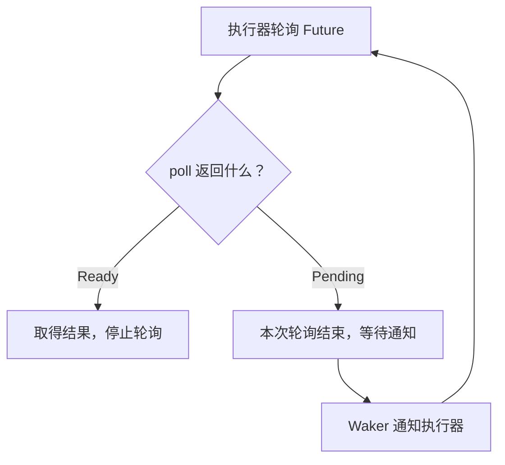

# 25.5 异步编程

`async fn` 被调用时返回一个 Future，函数体要等到 Future 被轮询才开始执行。Rust 的编译器负责 `async` 与 `.await` 语法；标准库提供 Future 接口，但不内置通用任务执行器。

## 25.5.1 核心构件 `Future`

`poll` 接受固定的可变引用和当前任务的 `Context`。它可能返回：

- `Poll::Ready(value)`：已完成。通常不要再次轮询这个 Future。
- `Poll::Pending`：目前无法完成。负责等待的 Future 使用 `Context` 中的 `Waker` 安排在可能取得进展时唤醒任务。

唤醒只通知执行器安排再次轮询，不保证下一次必定就绪；部分唤醒也可能合并。



## 25.5.2 语法糖 `async/await`

`future.await` 不是宏。它会尝试推进内部的 Future；如果内部 Future 尚未就绪，外层异步逻辑把控制权交回，而不是阻塞线程。当内部 Future 就绪后，`.await` 得到结果并继续。

下面只轮询一次，因为被等待的 `ready` 已经就绪。这里的空操作 `Waker` 仅用于演示，不是可等待 I/O 的执行器。

```rust
use std::future::{ready, Future};
use std::pin::pin;
use std::task::{Context, Poll, Waker};

async fn answer() -> u32 {
    let value = ready(40).await;
    value + 2
}

fn main() {
    let mut future = pin!(answer());
    let mut cx = Context::from_waker(Waker::noop());
    assert_eq!(future.as_mut().poll(&mut cx), Poll::Ready(42));
}
```

`#[tokio::main]` 等是第三方运行时提供的入口属性宏，用于启动执行器；它们不是使用 `async/await` 语法的前提。
