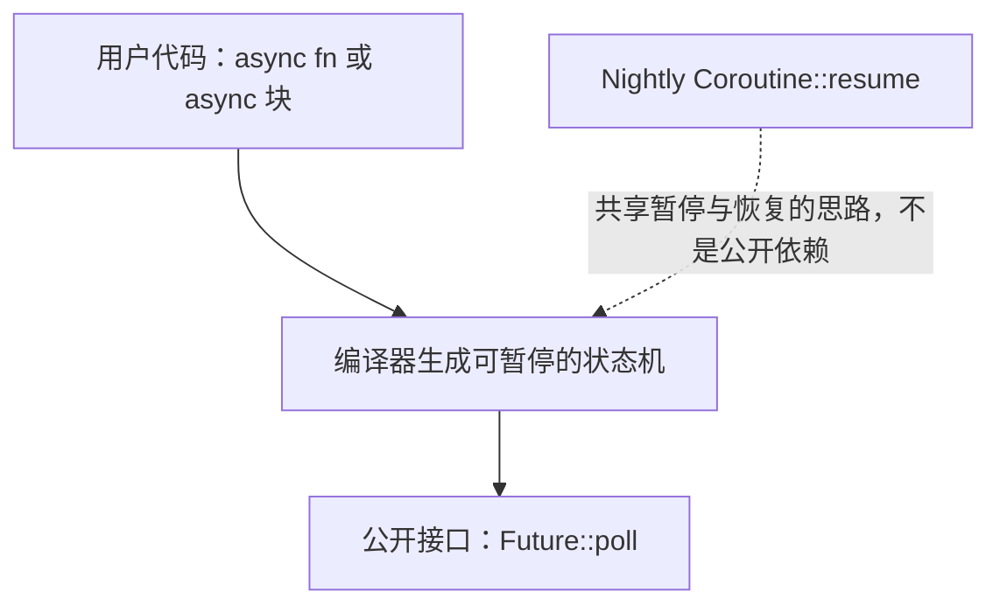

# 25.6 Coroutine 与 Future

`Coroutine` trait 和 `Future` trait 没有直接的公开依赖。两者都适合用暂停、恢复和状态保存来理解。

| | `Future` | `Coroutine` |
| --- | --- | --- |
| 推进一步 | `poll(Pin<&mut Self>, &mut Context)` | `resume(Pin<&mut Self>, arg)` |
| 暂停 | `Pending`，通常通过 Waker 安排重试；不产出中间结果 | `Yielded(value)`，直接给调用方一个值 |
| 完成 | `Ready(output)` | `Complete(value)` |
| 在 Rust 1.100 使用 | 稳定 | Nightly：`coroutines` / `coroutine_trait` |

### **第一层：两个独立的基础构件（在 `std` 库中）**

想象一下，标准库（`std`）为我们提供了两种不同但功能强大的乐高积木：

#### **1. `std::future::Future` Trait**
*   **角色**：一个**公开、稳定**的接口，用于定义“异步计算”。
*   **核心 API**：`fn poll(self: Pin<&mut Self>, cx: &mut Context<'_>) -> Poll<Self::Output>`
*   **设计目的**：为整个 Rust 生态系统提供一个**统一的异步任务规范**。任何库（如 `tokio`, `async-std`）只要能处理实现了 `Future` trait 的类型，就能融入 Rust 的异步生态。它定义了异步任务的“外部行为”——如何被轮询（poll）和唤醒（wake）。
*   **它关心什么？**：只关心“是否完成”（`Poll::Ready` 或 `Poll::Pending`），不关心“如何实现暂停和恢复”。你可以用任何方式去实现 `Future`，比如手写一个复杂的状态机。

#### **2. `std::ops::Coroutine` Trait**
*   **角色**：一个**公开但不稳定（Nightly-only）**的实验性接口，用于实现“可暂停恢复的计算”。
*   **核心 API**：`fn resume(self: Pin<&mut Self>, arg: R) -> CoroutineState<Self::Yield, Self::Return>`
*   **设计目的**：描述可暂停计算如何产出中间值，以及调用方如何恢复它。它定义了计算过程的“内部机制”——如何暂停（yield）、如何恢复（resume）以及如何传递值。
*   **它关心什么？**：只关心“暂停和恢复”的底层逻辑，不关心“为什么暂停”（比如等待 I/O）或“谁来唤醒我”。

> **关键洞察**：在 `std` 层面，`Future` 和 `Coroutine` 是两个正交（Orthogonal）的概念。`Future` 是**面向生态的协议**，而 `Coroutine` 是**实验性的暂停与恢复接口**。它们被设计为可以独立存在，这增加了语言的灵活性和模块化程度。

### **第二层：`async/await` —— 胶水和魔法的来源（在编译器中）**

现在，我们有了两种积木，但它们如何协同工作来构建出我们想要的城堡（即 `async` 函数）呢？这就是 `async/await` 语法和编译器发挥作用的地方。

**`async/await` 是编译器提供的语法。** 可以借协程状态机和适配器理解它，但不是所有 Future 都依赖公开的 `Coroutine` trait。

当你写下这段代码时：
```rust
# async fn some_other_future() -> u8 { 1 }
# async fn another_future(value: u8) -> u8 { value + 1 }
async fn my_async_function() -> u8 {
    let a = some_other_future().await;
    let b = another_future(a).await;
    b + 1
}
```

可以用以下两个层次理解编译器在背后的工作：

#### **第一层转换：生成状态机**

编译器为 `async` 函数体构造匿名状态机。其公开的对外行为是实现 `Future`，内部协程表示属于实现细节。
*   可以把每次 `poll` 看作从保存的位置推进函数体。
*   每一个 `.await` 都是可能的暂停点；若被等待的 Future 立即就绪，则不会暂停。
*   跨暂停点仍然需要的局部变量由状态机保存。
*   暂停和恢复的流程可用下一段适配伪代码来理解。

#### **第二层转换：理解公开的 Future 接口**

可以用一个适配器来说明如何将“暂停／完成”翻译成 Future 的 `Pending`／`Ready`。下面是解释用的伪代码，不是对编译器生成类型、布局或上下文传递机制的承诺。

这个适配器的 `poll` 方法的实现逻辑（概念上）是这样的：
```text
// 伪代码：关注分支行为，略去实际类型、Pin 投影与编译器内部接口。
struct FutureAdapter {
    state_machine: 可暂停的状态机,
}

impl Future for FutureAdapter {
    type Output = 任务结果类型;

    fn poll(self: Pin<&mut Self>, cx: &mut Context<'_>) -> Poll<Self::Output> {
        // 先根据已保存的状态推进异步代码。
        // 遇到 .await 时，用当前 Context 轮询等待的 Future。
        match advance_state_machine(self, cx) {
            // 等待的 Future 暂时无法完成，已安排在可能进展时唤醒当前任务。
            Suspended => Poll::Pending,
            // 完成整个 async 函数体，交出它的返回值。
            Returned(result) => Poll::Ready(result),
        }
    }
}
```

把它与 `Coroutine::resume` 比较：普通协程可以把中间值交给调用者，Future 的 `Pending` 则没有载荷。下一次轮询也不是给 `.await` 直接传入一个结果，而是让保存下来的内部 Future 再尝试前进一步。

原书的适配思路还需要回答一个问题：如何把执行器的唤醒信息传给嵌套计算？在公开接口里，这一信息经 `Context` 传给被轮询的 Future；在上一节的取餐类比里，它就是每次询问时留下的联系方式。无需假定编译器会把 `Waker` 存到线程局部变量中。

### **图解：三者关系**



### **总结：为什么这样设计？**

将“如何保存暂停状态”和公开的 Future 协议分开，带来了几个巨大的好处：

1.  **稳定与实验分离**：`Future` trait 作为生态的基石，可以保持**长期稳定**。而公开的实验性 `Coroutine` trait，可以在 Nightly 版本中**不断迭代和演进**，而不会破坏现有的异步代码。稳定 `async/await` 无需稳定公共 `Coroutine` 接口。

2.  **关注点分离 (Separation of Concerns)**：
    *   `Future` 关注“是什么”：一个异步的值。
    *   `Coroutine` 关注“怎么做”：一种实现可暂停计算的方式。
    *   `async/await` 关注“怎么写”：提供符合人体工程学的语法。

3.  **灵活性和可扩展性**：因为 `Future` 和 `Coroutine` 是独立的，理论上 Rust 未来可以引入其他实现 `Future` 的方式，或者让 `Coroutine` 用于 `Future` 之外的其他场景（比如同步生成器），而不需要进行破坏性更改。

可以用协程的比喻理解 `async/await` 如何运行，但编写应用代码时，只需依赖稳定的 `Future` 协议和语言语法。
