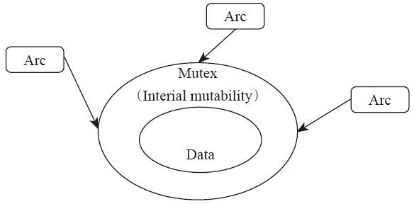

# 29.2 Mutex

上一节的 `Arc` 负责共享所有权，但只靠 `Arc` 不能同时修改内部值。Rust 标准库提供的互斥锁 `Mutex<T>` 把数据包在锁里。每次只有一个线程能拿到锁并访问内部数据。

下面用 `Arc` 与 `Mutex` 配合。两个线程操作同一个整数：一个总是加 1，另一个总是减 1。

```rust
use std::sync::Arc;
use std::sync::Mutex;
use std::thread;

const COUNT: u32 = 1_000_000;

fn main() {
    let global = Arc::new(Mutex::new(0));

    let clone1 = global.clone();
    let thread1 = thread::spawn(move || {
        for _ in 0..COUNT {
            let mut value = clone1.lock().unwrap();
            *value += 1;
        }
    });

    let clone2 = global.clone();
    let thread2 = thread::spawn(move || {
        for _ in 0..COUNT {
            let mut value = clone2.lock().unwrap();
            *value -= 1;
        }
    });

    thread1.join().unwrap();
    thread2.join().unwrap();
    assert_eq!(*global.lock().unwrap(), 0);
}
```

闭包使用 `move`，因此每次启动线程之前先克隆一个 `Arc`。各线程有自己的指针，指向同一把锁；主线程仍能在 `join` 后验证结果。如果用第 27 章的 `thread::scope`，子线程也可以直接借用 `&Mutex<T>`，不必用 `Arc`。

每次修改时，`lock()` 会等待锁；`try_lock()` 如果无法立即拿到锁，则返回错误。示例把一次读取、计算和写回放在同一个临界区内，其他线程不能在这个过程中改变值。与此对应，标准库的 trait 实现如下（接口摘录）：

```text
unsafe impl<T: ?Sized + Send> Send for Mutex<T> {}
unsafe impl<T: ?Sized + Send> Sync for Mutex<T> {}
```

所以 `Arc<Mutex<isize>>` 可以在多个线程间共享；这里并不要求受保护的 `T` 本身是 `Sync`。

## 29.2.1 取得守卫与释放锁

以下是 `lock` 和其返回类型的接口摘录：

```text
pub fn lock(&self) -> LockResult<MutexGuard<'_, T>>

pub type LockResult<T> = Result<T, PoisonError<T>>;
```

`MutexGuard` 实现了 `Deref` 与 `DerefMut`，所以可以用 `*value` 读写内部值。守卫离开作用域时自动解锁，这是 RAII 的用法，不需要手动调用 `unlock`。




## 29.2.2 锁中毒

如果线程持锁时 panic，锁通常会被标记为**中毒**（poisoned）。后续拿到锁时会收到 `PoisonError`，提示内部数据可能没有恢复到一致状态。错误中仍包含守卫，可以在确认可恢复时用 `into_inner()` 取得它，修复数据后用 `clear_poison()` 清除标记。中毒只是提示，不是 `unsafe` 实现可以依赖的安全保证。

## 29.2.3 顺着编译错误推导

Rust 的这个设计，优点不只在于它“允许你做什么”，还在于它“不允许你做什么”。如果用 `Rc<isize>` 跨线程共享，`Rc` 不满足 `Send`；换成 `Arc<isize>` 后虽能共享，却不能通过共享指针写入。再换成 `Arc<RefCell<_>>`，仍会报错：`RefCell` 不是 `Sync`，所以不能让这个 `Arc` 跨线程。

使用 `Arc<Mutex<_>>` 后，类型要求调用者先获得守卫，才有机会读写真正的数据。守卫析构负责释放锁：不会因为忘记显式解锁而漏掉正常的释放步骤。不过，如果代码保持多把锁的顺序不一致，仍可能出现下一节之后讨论的死锁。
