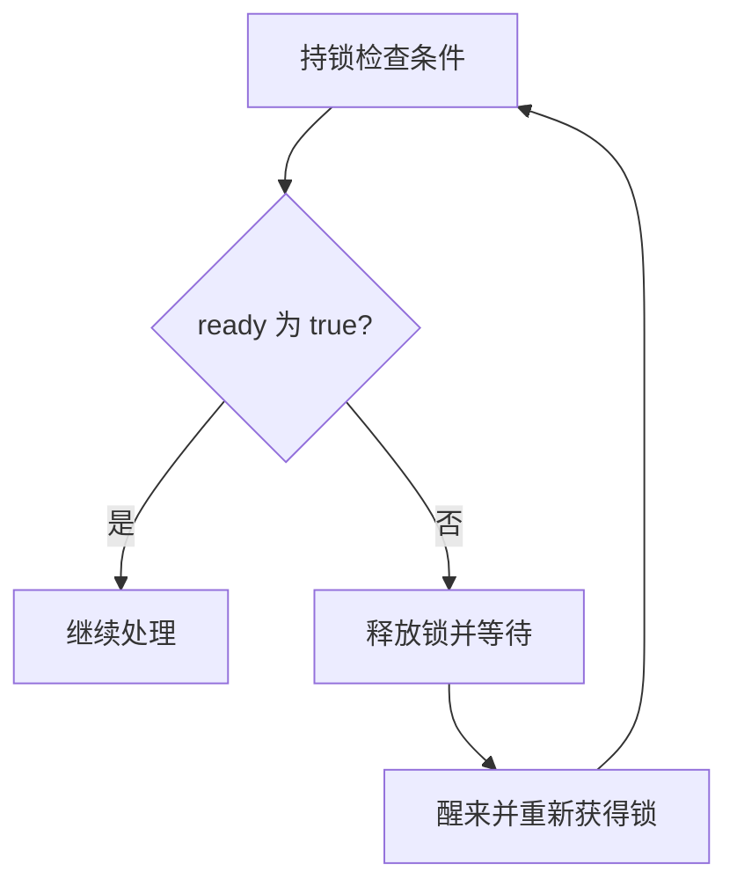

# 29.7 Condvar

Condvar 是条件变量，用于等待某个共享状态满足条件。线程阻塞时不需要不断轮询。调用 `wait` 时要传入一个 `MutexGuard`，条件变量会释放同一把锁，醒来时重新获得它；同一个 Condvar 不应与不同的 Mutex 混用，否则可能 panic。

常见用法是用 `Mutex<bool>` 保存状态。子线程完成工作后修改这个状态，并通知等待的主线程。下面用 `Arc` 共享这个组合：

```rust
use std::{sync::{Arc, Condvar, Mutex}, thread};

fn main() {
    let pair = Arc::new((Mutex::new(false), Condvar::new()));
    let child_pair = Arc::clone(&pair);

    let child = thread::spawn(move || {
        let (lock, changed) = &*child_pair;
        // 更新状态，再通知正在等待的线程。
        *lock.lock().unwrap() = true;
        changed.notify_one();
    });

    let (lock, changed) = &*pair;
    {
        let mut ready = lock.lock().unwrap();
        while !*ready {
            ready = changed.wait(ready).unwrap();
        }
        assert!(*ready);
    }
    child.join().unwrap();
}
```

如果主线程拿到锁时看到条件已经成立，就不必等待。如果还没成立，它交出守卫进入等待，子线程就能获得锁并把状态改为 `true`。即使一次唤醒是虚假的，循环仍会重新检查状态。



通知不会像消息一样排队。若通知在主线程开始等之前就发出，主线程仍会在持锁检查时看到 `true`。标准库还提供 `wait_while(guard, |ready| !*ready)`，可以替代上面的循环。
