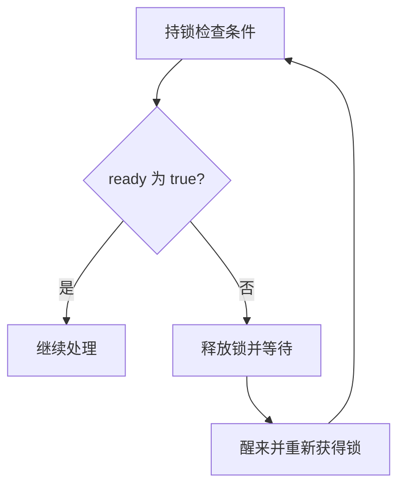

# 29.7 Condvar

条件变量 `Condvar` 和同一把 `Mutex` 搭配使用：锁保护状态，条件变量让线程在状态可能改变时醒来。等待过程中，`wait` 会释放锁；返回时已重新持有锁。由于可能发生虚假唤醒，每次醒来都要重新检查条件。

```rust
use std::{sync::{Condvar, Mutex}, thread};

fn main() {
    let ready = Mutex::new(false);
    let changed = Condvar::new();

    thread::scope(|scope| {
        scope.spawn(|| {
            *ready.lock().unwrap() = true;
            changed.notify_one();
        });

        let guard = ready.lock().unwrap();
        let guard = changed.wait_while(guard, |ready| !*ready).unwrap();
        assert!(*guard);
    });
}
```



`wait_while` 内部封装了检查循环。即使通知在主线程等待前发出，只要状态已是 `true`，主线程也会直接继续；通知本身不会像消息一样排队。
