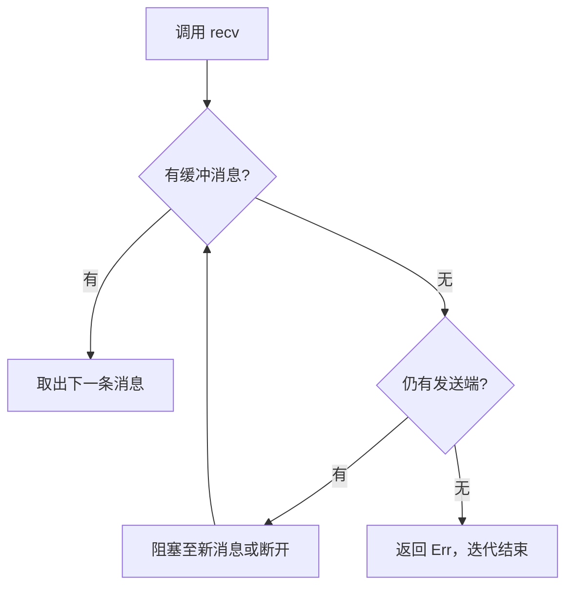

# 30.1 异步管道

[`mpsc::channel`](https://doc.rust-lang.org/std/sync/mpsc/fn.channel.html) 的接口如下：

```text
pub fn channel<T>() -> (Sender<T>, Receiver<T>)
```

这个二元组里，一个是发送者，另一个是接收者。发送者通过 `send` 把消息交给队列，接收者通过 `recv` 或迭代器取出消息。构造管道本身不要求 `T: Send`；当把端点移到另一个线程时，消息类型才需要满足 `Send`。

## 30.1.1 单发送端

先看一个生产者按顺序把整数交给主线程的例子：

```rust
use std::{sync::mpsc::channel, thread};

fn main() {
    let (tx, rx) = channel();
    let sender = thread::spawn(move || {
        for i in 0..10 {
            tx.send(i).unwrap();
        }
    });

    while let Ok(n) = rx.recv() {
        println!("received {n}");
    }
    sender.join().unwrap();
}
```

`channel` 是泛型函数，这里没有显式指定 `T`，因为 `send(i)` 已让编译器推导出消息类型。两端使用同一个 `T`，所以接收者接到的类型与发送者一致。发送者移入子线程，按顺序把整数入队；主线程取到的顺序相同。当子线程退出，发送者被丢弃，接收完剩余的消息后循环就会终止。

## 30.1.2 多发送端

`Sender` 可以用 `clone()` 产生另一个指向同一队列的发送端，`Receiver` 则不可克隆。下面改成每个线程发送一条消息：

```rust
use std::{sync::mpsc::channel, thread};

fn main() {
    let (tx, rx) = channel();
    thread::scope(|scope| {
        for n in [1, 2] {
            let tx = tx.clone();
            scope.spawn(move || tx.send(n).unwrap());
        }
        drop(tx);

        let mut received: Vec<_> = rx.into_iter().collect();
        received.sort_unstable();
        assert_eq!(received, [1, 2]);
    });
}
```

两个线程各持有一个发送端，发送顺序不固定。原始的 `tx` 也必须丢弃，否则即使两个线程都结束，接收迭代器仍会等待下一个消息。



接收端先被丢弃时，`send` 返回 `SendError<T>`，可从错误中取回未发送的消息。反过来，全部发送端被丢弃后，接收端会先取完已入队的消息，然后才收到断开错误。若不能阻塞当前线程，可用 `try_recv` 区分当前无消息和管道已断开。
