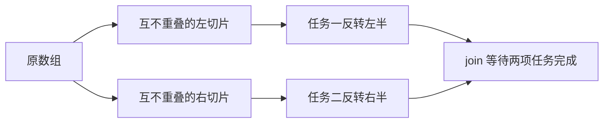

# 31.5 Rayon

[Rayon](https://docs.rs/rayon/latest/rayon/) 将独立计算交给工作线程池，适合数据并行和分治。线程池会用**工作窃取**调度任务：空闲工作线程可以从别的工作线程接手任务。但并行有调度和分割开销，小任务不一定更快。

在 Edition 2024 的 Cargo 项目中安装依赖，再把下面的代码放到 `src/main.rs`，用 `cargo run` 运行。示例依赖外部 crate，单文件 `rustc` 审计跳过此围栏。

```sh
cargo add rayon@1
```

```rust,ignore,no_run
use rayon::prelude::*;

fn main() {
    let mut values = [1, 2, 3, 4];
    let squares: i32 = values.par_iter().map(|&n| n * n).sum();
    assert_eq!(squares, 30);

    values.par_iter_mut().for_each(|n| *n += 1);
    assert_eq!(values, [2, 3, 4, 5]);

    let (left, right) = values.split_at_mut(2);
    rayon::join(|| left.reverse(), || right.reverse());
    assert_eq!(values, [3, 2, 5, 4]);
}
```



`par_iter` 可用于分别计算，再把结果合并；`par_iter_mut` 则让任务独占不同元素。`join` 不保证两个闭包一定同时执行，也不能让它们同时可变借用同一个切片；上例先用 `split_at_mut` 证明两份借用不重叠。需要对整个切片排序时，优先用现成的 `par_sort` 或 `par_sort_unstable`。
