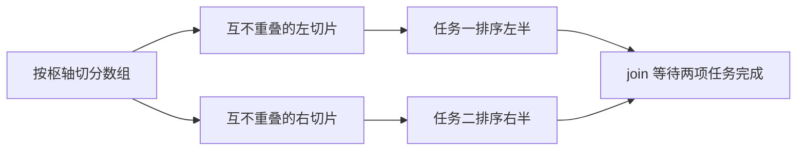

# 31.5 Rayon

C# 的 LINQ 有一套 PLINQ 扩展，可以并行处理查询。例如：

```csharp
using System;
using System.Linq;

string[] words = new[] { "Welcome", "to", "Beijing","OK","Hua","Ying","Ni" ,"2008"};
var lazyBeeQuery = from word in words.AsParallel() select word;
lazyBeeQuery.ForAll<string>(word => { Console.WriteLine(word); });
```

C++17 也给部分标准库算法提供了执行策略，例如：

```cpp
#include <algorithm>
#include <execution>
#include <vector>

void increment(std::vector<int>& v) {
    std::for_each(std::execution::par, v.begin(), v.end(), [](int& n) {
        ++n;
    });
}
```

Rust 的迭代器同样能把计算步骤串起来。能不能在保留迭代器用法的同时，让相互独立的操作并行执行？这就是 Rayon 的设计目标。

[Rayon](https://docs.rs/rayon/latest/rayon/) 将独立计算交给工作线程池，适合数据并行和分治。线程池会用**工作窃取**调度任务：空闲工作线程可以从别的工作线程接手任务。但并行有调度和分割开销，小任务不一定更快。

在 Edition 2024 的 Cargo 项目中安装依赖，再把下面的代码放到 `src/main.rs`，用 `cargo run` 运行。本节的 Rayon 示例依赖外部 crate，单文件 `rustc` 审计跳过这些围栏。

```sh
cargo add rayon@1
```

## 31.5.1 并行迭代器

例如，对一组数逐个求平方，再归约成总和。每个平方运算不依赖别的元素，所以可用 `par_iter()` 代替 `iter()`。并行版本也支持可变迭代：

```rust,ignore,no_run
use rayon::prelude::*;

fn main() {
    let mut values = [1, 2, 3, 4];
    let squares: i32 = values.par_iter().map(|&n| n * n).sum();
    assert_eq!(squares, 30);

    values.par_iter_mut().for_each(|n| *n += 1);
    assert_eq!(values, [2, 3, 4, 5]);
}
```

Rayon 把可迭代的数据分成较小任务，在线程池里执行并合并结果。`par_iter_mut` 所处理的元素各自独立，工作线程不会得到指向同一个元素的两份可变引用。

## 31.5.2 用 join 实现分治

对于快速排序，可以先把枢轴放到最终位置，再分别处理左右两段。下面的 `partition` 以最后一个元素为枢轴，把不大于它的元素移到左边，最后将枢轴交换到正确位置。随后用 `split_at_mut` 分离两段，跳过枢轴本身：

```rust,ignore,no_run
fn partition<T: Ord>(v: &mut [T]) -> usize {
    let pivot = v.len() - 1;
    let mut i = 0;
    for j in 0..pivot {
        if v[j] <= v[pivot] {
            v.swap(i, j);
            i += 1;
        }
    }
    v.swap(i, pivot);
    i
}

fn quick_sort<T: Ord + Send>(v: &mut [T]) {
    if v.len() <= 1 {
        return;
    }

    let mid = partition(v);
    let (lo, pivot_and_hi) = v.split_at_mut(mid);
    let hi = &mut pivot_and_hi[1..];
    rayon::join(|| quick_sort(lo), || quick_sort(hi));
}

fn main() {
    let mut v = [10, 9, 6, 9, 5, 4, 2, 3, 1];
    quick_sort(&mut v);
    assert_eq!(v, [1, 2, 3, 4, 5, 6, 9, 9, 10]);
}
```

下面的图展示两个递归调用如何拆分工作：



并行迭代器和 `join` 不会为每个任务都新建线程。以 `join` 为例，另一个空闲工作线程可能窃取尚未执行的任务，否则当前线程仍可以完成两个任务。因此两个闭包并不保证同时运行。这个快速排序只用于讲解分治：固定选末尾作枢轴可能导致切分极不均匀，实际排序优先使用 `par_sort` 或 `par_sort_unstable`。

## 31.5.3 为什么必须先切分

如果两个闭包同时可变借用同一个切片，编译器不会因为它们可能在同一线程上顺序执行就放行。用不依赖外部 crate 的作用域线程，可以看清同样的借用错误：

```rust,compile_fail,no_run
use std::thread;

fn main() {
    let mut values = [1, 2, 3, 4];
    thread::scope(|scope| {
        scope.spawn(|| values[0] += 1);
        scope.spawn(|| values[0] -= 1);
    });
}
```

预期报错 **E0499**：第二个闭包试图在第一个可变借用仍有效时再次借用。Rayon 同样依赖 Rust 的借用规则和 `Send` 等约束：先用 `split_at_mut` 将切片分成互不重叠的两部分，再分别交给两个任务。
