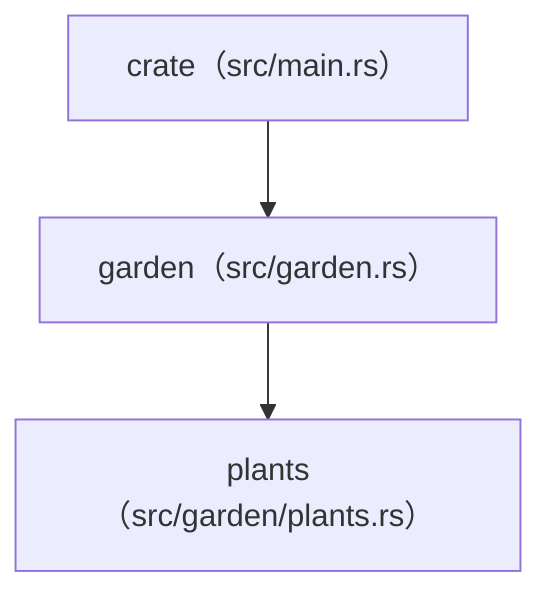

# 32.3 模块管理

一个 crate 是一个编译单元；模块（module）是在 crate 内组织代码和控制可见性的方式。依赖也是独立的 crate，例如 `hello_world` 可以调用 `good_bye::say()`，但 `good_bye` 并不是 `hello_world` 的子模块。

## 32.3.1 文件组织

Cargo 默认以 `src/lib.rs` 为库 crate 的根，以 `src/main.rs` 为同名二进制 crate 的根。以下是一个二进制 crate 的模块树（`crate` 表示当前 crate 的根）：



目录里有 `.rs` 文件，不等于已经声明了模块。从 crate 根开始，用 `mod` 把子模块接入模块树：

| 声明位置 | 写法 | 模块内容 |
| --- | --- | --- |
| `src/main.rs` | `mod garden { /* 模块内容 */ }` | 内联，直接写在花括号里 |
| `src/main.rs` | `mod garden;` | `src/garden.rs` 或 `src/garden/mod.rs` |
| `src/garden.rs` 或 `src/garden/mod.rs` | `mod plants;` | `src/garden/plants.rs` 或 `src/garden/plants/mod.rs` |

这里的“模块”是一种抽象，文件是承载它的实体，两者不是一一对应。小模块（比如单元测试）可以内联；内容变多时再分出文件，把更细的实现放入子模块中。

同一个模块只能选择一种写法：如果 `garden.rs` 和 `garden/mod.rs` 同时存在，`mod garden;` 会报错（E0761）。`garden.rs` 与子目录 `garden/` 则可以共存：前者写父模块，后者存放子模块文件。

下面的单文件例子与图中的层级相同。拆分时，把 `garden` 花括号里的内容移到 `garden.rs`，把 `plants` 花括号里的内容移到 `garden/plants.rs`，并把两处内联模块声明分别改为 `mod garden;` 和 `pub mod plants;`。调用路径不用改。

```rust
mod garden {
    pub mod plants {
        pub fn name() -> &'static str {
            "薄荷"
        }
    }
}

fn main() {
    assert_eq!(crate::garden::plants::name(), "薄荷");
}
```

比如，我们有一个库 crate 内部包含了两个模块，一个是 `caller` 一个是 `worker`。我们可以有几种方案来实现。

方案一：直接把所有代码都写到`lib.rs`里面：

```rust
// <lib.rs>
mod caller {
    fn call() {}
}

mod worker {
    fn work1() {}
    fn work2() {}
    fn work3() {}
}
```

方案二：把这两个模块分到两个不同的文件中，分别叫作`caller.rs`和`worker.rs`。

两种方式也可以混用。用方案二时，`src/lib.rs` 接入两个同目录的文件，`caller.rs` 和 `worker.rs` 各自存放方案一对应花括号内的函数：

```rust,ignore,no_run
mod caller;
mod worker;
```

只有把 `mod` 声明接入模块树，编译器才会把对应文件当作源码。还可以继续拆分：如果 `worker.rs` 太大，把三个工作函数各自移入 `worker/` 下的文件。

```text
src/
├── lib.rs
├── caller.rs
├── worker.rs
└── worker/
    ├── worker1.rs
    ├── worker2.rs
    └── worker3.rs
```

`src/worker.rs` 需要声明这三个子模块；下面的片段须与三个子模块文件放在同一个项目中：

```rust,ignore,no_run
mod worker1;
mod worker2;
mod worker3;
```

例如，`worker/worker1.rs` 放 `fn work1() {}`，另外两个文件也各放相应函数。旧布局也可以把 `worker.rs` 改成 `worker/mod.rs`，子文件的位置不变。方式不同不等于模块路径改变：`worker` 重导出原先公开的函数后，`caller` 就可以保留原来的调用路径。

## 32.3.2 可见性

我们可以给模块内部的元素指定可见性。因为默认都是私有，除了两种例外情况：
- 用 `pub` 修饰的 trait 内部的关联元素（associated item），默认是公开的；
- `pub enum` 内部的成员默认是公开的。

公开和私有的访问权限是这样规定的：

- 如果一个元素是私有的，那么只有本模块内的元素以及它的子模块可以访问；
- 如果一个元素是公开的，调用方还要有一条能访问它的路径。可以公开路径上的模块，也可以通过重导出另开一条路径。

示例如下：

```rust
mod top_mod1 {
    pub fn method1() {}

    pub mod inner_mod1 {
        pub fn method2() {}

        fn method3() {}
    }

    mod inner_mod2 {
        fn method4() {}

        mod inner_mod3 {
            fn call_fn_inside() {
                super::method4();
            }
        }
    }
}

fn call_fn_outside() {
    crate::top_mod1::method1();
    crate::top_mod1::inner_mod1::method2();
}
```

在这个示例中，`top_mod1`外部的函数`call_fn_outside()`，有权访问`method1()`，因为它是用 `pub` 修饰的。同样也可以访问`method2()`，因为`inner_mod1`是 pub 的，而且`method2`也是 pub 的。而`inner_mod2`不是 pub 的，所以外部的函数是没法访问`method4`的。但是`call_fn_inside`是有权访问`method4`的，因为它在`method4`所处模块的子模块中。

模块内的元素可以使用 `pub use` 重新导出（re-export）。这也是 Rust 模块系统的一个重要特点。
示例如下：

```rust
mod top_mod1 {
    pub use self::inner_mod1::method1;

    mod inner_mod1 {
        pub use self::inner_mod2::method1;

        mod inner_mod2 {
            pub fn method1() {}
        }
    }


}

fn call_fn_outside() {
    crate::top_mod1::method1();
}
```

在`call_fn_outside`函数中，我们调用了`top_mod1`中的函数`method1`。可是我们注意到，`method1`其实不是在`top_mod1`内部实现的，它只是把它内部`inner_mod1`里面的函数重新导出了而已。
`pub use`就是起这样的作用，可以把元素当成模块的直接成员公开出去。我们继续往下看还可以发现，这个函数在`inner_mod1`里面也只是重新导出的，它的真正实现是在`inner_mod2`里面。

这个机制可以让我们轻松做到接口和实现的分离。我们可以先设计好一个模块的对外 API，这个固定下来之后，它的具体实现是可以随便改，不影响外部用户的。我们可以把具体实现写到任何一个子模块中，然后在当前模块重新导出即可。对外部用户来说，这没什么区别。

上例逐层转发，便于每一层维护自己的接口，但不是必须的。如果重导出处可以访问完整路径，也可以一次重导出深层子模块的项；如果某个私有模块不可访问，就要从能访问的位置重导出，或者放宽该模块的可见性。

普通 `pub` 的实际可见性取决于调用方能访问的路径。还可以精确限制访问范围：

| 写法 | 范围 |
| --- | --- |
| `pub(self)` 或 `pub(in self)` | 当前模块和子模块，与默认私有相同 |
| `pub(super)` 或 `pub(in super)` | 父模块及其子模块 |
| `pub(crate)` | 当前 crate |
| `pub(in crate::top_mod)` | 指定祖先模块及其子模块 |

示例如下：

```rust
mod top_mod {
    pub mod inner_mod1 {
        pub mod inner_mod2 {
            pub(self) fn method1() {}
            pub(super) fn method2() {}
            pub(crate) fn method3() {}
        }

        fn caller1() {
            self::inner_mod2::method2();
            self::inner_mod2::method3();
        }
    }

    fn caller2() {
        self::inner_mod1::inner_mod2::method3();
    }
}

```

在`inner_mod2`模块中定义了几个函数。
`method1`用了`pub(self)`限制，那么它最多只能被这个模块以及子模块使用，在模块外部调用或者重新导出都会出错。
`method2`用了`pub(super)`限制，那么它的可见性最多就只能到`inner_mod1`这一层，在这层外面不能被调用或者重新导出。
而`method3`用了`pub(crate)`限制，那么它的可见性最多就只能到当前 crate 这一层，再继续往外重新导出，就会出错。

用本节前面的 `garden` 再作一个对照：即使 `name` 已重导出，绕过重导出直接经过私有的 `plants`，仍会得到 E0603（模块 `plants` 是私有的）。

```rust,compile_fail,no_run
pub mod garden {
    pub use self::plants::name;

    mod plants {
        pub fn name() -> &'static str {
            "薄荷"
        }
    }
}

fn main() {
    let _ = crate::garden::plants::name();
}
```

## 32.3.3 `use` 关键字

路径告诉编译器去哪里找一个名称，`use` 则把该名称引入当前作用域。`use` 不会加载模块文件，也不会改变原有项的可见性。

| 路径开头 | 从哪里找 |
| --- | --- |
| `crate::` | 当前 crate 的根 |
| `self::` | 当前模块 |
| `super::` | 父模块 |
| `std::`、`good_bye::` | 标准库或依赖的 crate（对应名称未被遮蔽时） |

::: tip 新版变化
Rust 2018 起，开头的 `::` 从外部 crate 查找名称。旧代码中的 `::top_mod1::f()` 若要指向当前 crate 的根，应改为 `crate::top_mod1::f()`；Cargo 依赖通常也不需要写 `extern crate`。
:::

* 以 `crate` 关键字开头的路径是绝对路径。它是从当前 crate 的根开始的完整路径：

```rust
mod top_mod1 {
    pub fn f1() {}
}

mod top_mod2 {
    pub fn call() {
        crate::top_mod1::f1(); // 当前 crate 下的 top_mod1
    }
}
```

* 以 `super` 关键字开头的路径是相对路径。它是从上层模块开始算的：

```rust
mod top_mod1 {
    pub fn f1() {}

    mod inner_mod1 {
        pub fn call() {
            super::f1(); // 当前模块 inner_mod1 的父级模块中的 f1 函数
        }
    }
}
```

* 以`self`关键字开头的路径是相对路径。它是从当前模块开始算的：

```rust
mod top_mod1 {
    pub fn f1() {}

    pub fn call() {
        self::f1();  // 当前模块 top_mod1 中的 f1 函数
    }
}
```

绝对路径不依赖调用处的模块位置，移动调用代码时更方便；相对路径把同一局部的项联系在一起，整体移动模块时往往更方便。

如果我们需要经常重复性地写很长的路径，那么可以使用`use`语句把相应的元素引入到当前的作用域中来。

* `use`语句可以用大括号，一句话引入多个元素：

```rust
use std::io::{self, Read, Write}; // 这句话引入了 io / Read / Write 三个名字
```

* `use`语句的大括号可以嵌套使用：

```rust
use std::{collections::{BTreeMap, HashMap}, io::{self, Read}};
```

* `use`语句可以使用星号，引入所有的元素：

```rust
use std::io::prelude::*;  // 这句话引入了 std::io::prelude 下面所有的名字
```

* `use` 不仅可放在模块中，还可放在函数体等块中，把导入限制在块内部：

```rust
fn call() {
    use std::collections::HashSet;

    let s = HashSet::<i32>::new();
}
```

* `use`语句允许使用`as`重命名，避免名字冲突：

```rust
use std::result::Result as StdResult;
use std::io::Result as IoResult;
```

## 包名问题

Cargo 包名允许连字符，但 Rust 标识符不允许。比如库包 `my-lib` 默认对应 crate 名 `my_lib`，代码里写 `use my_lib::funx;`。

也可以在 `Cargo.toml` 里显式给依赖取别名。以下配置把相邻目录里的 `my-alib` 包引入为 `my_lib`：

```toml
[dependencies]
my_lib = { path = "../my-alib", package = "my-alib" }
```
