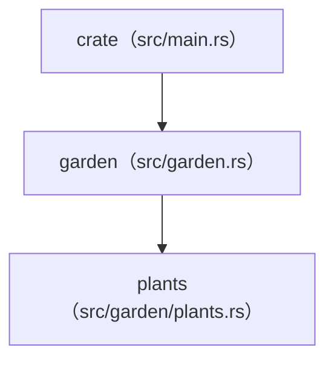

# 32.3 模块管理

一个 crate 是一个编译单元；模块（module）是在 crate 内组织代码和控制可见性的方式。依赖也是独立的 crate，例如 `hello_world` 可以调用 `good_bye::say()`，但 `good_bye` 并不是 `hello_world` 的子模块。

## 32.3.1 文件组织

Cargo 默认以 `src/lib.rs` 为库 crate 的根，以 `src/main.rs` 为同名二进制 crate 的根。以下是一个二进制 crate 的模块树（`crate` 表示当前 crate 的根）：



目录里有 `.rs` 文件，不等于已经声明了模块。从 crate 根开始，用 `mod` 把子模块接入模块树：

| 声明位置 | 写法 | 模块内容 |
| --- | --- | --- |
| `src/main.rs` | `mod garden { /* 模块内容 */ }` | 内联，直接写在花括号里 |
| `src/main.rs` | `mod garden;` | `src/garden.rs` 或 `src/garden/mod.rs` |
| `src/garden.rs` 或 `src/garden/mod.rs` | `mod plants;` | `src/garden/plants.rs` 或 `src/garden/plants/mod.rs` |

同一个模块只能选择一种写法：如果 `garden.rs` 和 `garden/mod.rs` 同时存在，`mod garden;` 会报错（E0761）。`garden.rs` 与子目录 `garden/` 则可以共存：前者写父模块，后者存放子模块文件。

下面的单文件例子与图中的层级相同。拆分时，把 `garden` 花括号里的内容移到 `garden.rs`，把 `plants` 花括号里的内容移到 `garden/plants.rs`，并把两处内联模块声明分别改为 `mod garden;` 和 `pub mod plants;`。调用路径不用改。

```rust
mod garden {
    pub mod plants {
        pub fn name() -> &'static str {
            "薄荷"
        }
    }
}

fn main() {
    assert_eq!(crate::garden::plants::name(), "薄荷");
}
```

## 32.3.2 可见性

模块中的项默认私有：定义该项的模块和它的子模块可以访问它。`pub` 允许路径外部访问，但路径上的各级模块也要对调用方可见。公开 trait 的关联项和公开枚举的变体随所属项一起公开。

| 写法 | 可见范围 |
| --- | --- |
| 不写 `pub`，或写 `pub(self)` | 当前模块及其子模块 |
| `pub(super)` | 父模块及其子模块 |
| `pub(crate)` | 当前 crate |
| `pub(in crate::garden)` | 指定的祖先模块及其子模块 |
| `pub` | 不限制该项本身；仍需有可访问的路径 |

如果只想开放一个函数，不必把实现模块也公开；可以用 `pub use` 给它提供一条公开路径。

```rust
pub mod garden {
    pub use self::plants::name;

    mod plants {
        pub fn name() -> &'static str {
            "薄荷"
        }
    }
}

fn main() {
    assert_eq!(crate::garden::name(), "薄荷");
}
```

下面是相应的反例：绕过重导出直接经过私有的 `plants`，会得到 E0603（模块 `plants` 是私有的）。

```rust,compile_fail,no_run
pub mod garden {
    pub use self::plants::name;

    mod plants {
        pub fn name() -> &'static str {
            "薄荷"
        }
    }
}

fn main() {
    let _ = crate::garden::plants::name();
}
```

## 32.3.3 `use` 关键字

路径告诉编译器去哪里找一个名称，`use` 则把该名称引入当前作用域。`use` 不会加载模块文件，也不会改变原有项的可见性。

| 路径开头 | 从哪里找 |
| --- | --- |
| `crate::` | 当前 crate 的根 |
| `self::` | 当前模块 |
| `super::` | 父模块 |
| `std::`、`good_bye::` | 标准库或依赖的 crate（对应名称未被遮蔽时） |

::: tip 新版变化
Rust 2018 起，开头的 `::` 从外部 crate 查找名称。旧代码中的 `::top_mod1::f()` 若要指向当前 crate 的根，应改为 `crate::top_mod1::f()`；Cargo 依赖通常也不需要写 `extern crate`。
:::

`use` 支持用花括号分组（可以嵌套）、用 `as` 取别名，或用 `*` 导入所有可见名称。比如下面同时引入 `std::io`、`std::io::Read`，并给 `Cursor` 取别名：

```rust
use std::io::{self, Cursor as Buffer, Read};

fn main() -> io::Result<()> {
    let mut input = Buffer::new(b"hello");
    let mut text = String::new();
    input.read_to_string(&mut text)?;
    assert_eq!(text, "hello");
    Ok(())
}
```

## 包名问题

Cargo 包名允许连字符，但 Rust 标识符不允许。比如库包 `my-lib` 默认对应 crate 名 `my_lib`，代码里写 `use my_lib::funx;`。

也可以在 `Cargo.toml` 里显式给依赖取别名。以下配置把相邻目录里的 `my-alib` 包引入为 `my_lib`：

```toml
[dependencies]
my_lib = { path = "../my-alib", package = "my-alib" }
```
