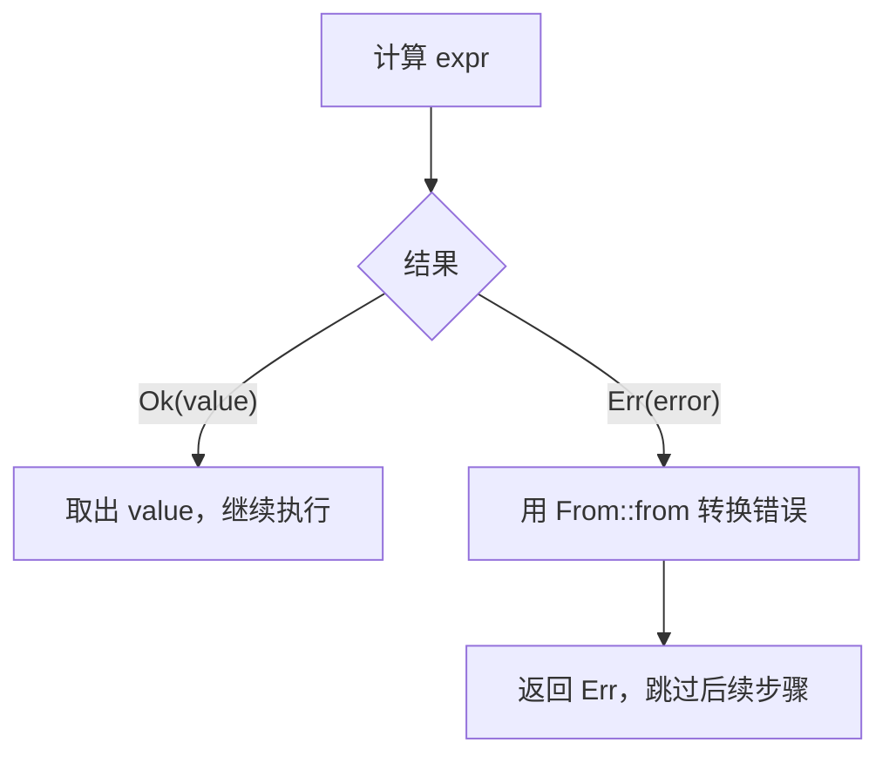

# 33.3 问号运算符

要从文件读取一个 `i32` 再将其翻倍，必须先读取文件，再解析内容。两步都可能失败；用 `?` 可以让成功路径保持直线，不必把每一步都放进 `match` 或 `and_then`。

## 传播和转换错误

对 `Result` 来说，`expr?` 取出 `Ok` 里的值继续执行；如果遇到 `Err`，就用 `From::from` 把错误转换成返回类型要求的错误，再提前返回。



例如，读取失败得到 `std::io::Error`，解析失败得到 `ParseIntError`。用枚举区分两种原因，各实现一个 `From`，就不必在每次调用时手写 `map_err`：

```rust
use std::{fs, io, num::ParseIntError, path::Path};

#[derive(Debug)]
enum MyError {
    Io(io::Error),
    Parse(ParseIntError),
}

impl From<io::Error> for MyError {
    fn from(error: io::Error) -> Self {
        Self::Io(error)
    }
}

impl From<ParseIntError> for MyError {
    fn from(error: ParseIntError) -> Self {
        Self::Parse(error)
    }
}

fn file_double(path: impl AsRef<Path>) -> Result<i64, MyError> {
    let contents = fs::read_to_string(path)?;
    let n = contents.trim().parse::<i32>()?;
    Ok(2 * i64::from(n))
}

fn main() {
    match file_double("number.txt") {
        Ok(n) => println!("{n}"),
        Err(MyError::Io(err)) => eprintln!("读取失败：{err}"),
        Err(MyError::Parse(err)) => eprintln!("解析失败：{err}"),
    }
}
```

可分别用内容为 `21` 的 `number.txt`、空文件和不存在的文件尝试：结果分别是 `42`、解析失败和读取失败。这里先转为 `i64` 再翻倍，以免 `i32` 溢出。

如果保留 `Result<i64, String>`，就需要在 `?` 前显式调用 `.map_err(|err| err.to_string())`，因为 `String` 没有为这两种错误提供相应的 `From` 实现。

## `Option` 和 `?`

`Option` 也支持 `?`：取出 `Some` 中的值，遇到 `None` 则提前返回 `None`。若函数返回 `Result`，应先用 `ok_or` 或 `ok_or_else` 把缺失转换成具体错误。

```rust
fn first_initial(name: Option<&str>) -> Option<char> {
    name?.chars().next()
}

fn main() {
    assert_eq!(first_initial(Some("Rust")), Some('R'));
    assert_eq!(first_initial(Some("")), None);
    assert_eq!(first_initial(None), None);
}
```

日常在稳定版使用 `?` 不需要特性开关；直接使用或实现 [`std::ops::Try`](https://doc.rust-lang.org/std/ops/trait.Try.html) 则仍需要 Nightly 和 `try_trait_v2`。

::: tip 新版变化
旧实验语法 `do catch` 已移除。稳定版可以把一组可失败的操作放进返回 `Result` 的函数或闭包，再在外面处理结果。
:::

例如，使用闭包把提前返回限制在闭包内：

```rust
use std::num::ParseIntError;

fn main() {
    let result = (|| -> Result<i32, ParseIntError> {
        let a = "20".parse::<i32>()?;
        let b = "22".parse::<i32>()?;
        Ok(a + b)
    })();
    assert_eq!(result, Ok(42));
}
```

Nightly 中还可以写 [`try { … }` 块](https://doc.rust-lang.org/unstable-book/language-features/try-blocks.html)（特性门槛：`#![feature(try_blocks)]`）。块内的 `?` 提前结束该块，而不是退出整个函数：

```rust:{channel:"nightly",edition:"2024"}
#![feature(try_blocks)]

use std::num::ParseIntError;

fn main() {
    let result: Result<i32, ParseIntError> = try {
        let a = "20".parse::<i32>()?;
        let b = "22".parse::<i32>()?;
        a + b
    };
    assert_eq!(result, Ok(42));
}
```

## 自定义枚举还是 `Box<dyn Error>`？

如果调用者不需要按类型分别处理，可以用 `Box<dyn std::error::Error>`。前例中的两种错误都实现了 `Error`，因此 `?` 可以把它们转为同一个返回类型。

```rust
use std::{error::Error, fs, path::Path};

fn file_double(path: impl AsRef<Path>) -> Result<i64, Box<dyn Error>> {
    let n = fs::read_to_string(path)?.trim().parse::<i32>()?;
    Ok(2 * i64::from(n))
}
```

| 表达方式 | 适合的场景 |
| --- | --- |
| 自定义枚举 | 调用方需要用 `match` 区分错误并采取不同操作 |
| `Box<dyn Error>` | 调用方主要转发或显示错误；必要时可尝试 `downcast_ref`，但没有穷尽性检查 |

如果公开的错误枚举以后可能新增变体，可以从最初就加上 `#[non_exhaustive]`。这样其他 crate 在匹配时必须提供兜底分支，新增变体后该分支仍可处理未知情况。

## 参考

- [Rust 程序设计语言：用 `?` 传播错误](https://doc.rust-lang.org/book/ch09-02-recoverable-errors-with-result.html#a-shortcut-for-propagating-errors-the--operator)
