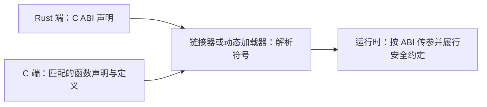

# 34.1 什么是 FFI

所谓外部函数接口（FFI），就是让一种语言编写的程序调用另一种语言的例程，或使用另一种语言提供的服务。

FFI 跨越的是编译后的接口，而不是把对方的源码当成本语言的一部分。声明签名、链接到库、调用时满足契约，是三个不同的步骤：



Rust 导出接口时，可以选用两种供其他语言链接的库类型：

| crate 类型 | 产物 | 适用场景 |
| --- | --- | --- |
| `staticlib` | 静态库，例如 Linux 上的 `.a` | 在构建调用方时链接 |
| `cdylib` | 动态库，例如 Linux 上的 `.so` | 运行时加载或动态链接 |

可以用 `rustc --help` 查看完整的 crate 类型列表。下面摘录类型选项：

```text
--crate-type <bin|lib|rlib|dylib|cdylib|staticlib|proc-macro>
```

注意 `dylib` 和 `cdylib` 不同：前者供 Rust 链接，后者用来提供给其他语言调用的接口。

可用 `rustc --crate-type=staticlib example.rs` 指定类型；Cargo 项目通常在 `Cargo.toml` 的 `[lib]` 表里配置 `crate-type = ["staticlib"]`。也可以在 crate 根写 `#![crate_type = "staticlib"]`，但命令行指定的类型优先。

C ABI 随目标平台而变：调用方与库的目标架构、ABI 和工具链要兼容。运行 `rustup show` 可查看默认主机，例如：

```text
Default host: x86_64-unknown-linux-gnu
```

交叉编译时，可用 `rustup target add` 安装其他目标的 Rust 标准库，例如：

```bash
rustup target add x86_64-pc-windows-msvc
```

这不会安装目标所需的链接器、C 工具链或系统 SDK。后面的编译和链接命令以 Linux GNU 目标为例。

::: tip 新版变化
`extern "C"` 指定调用约定，不会自动让 Rust 类型变成 C 兼容类型。Edition 2024 中，导入符号用 `unsafe extern "C" { … }`，导出固定名称用 `#[unsafe(no_mangle)]`（或 `#[unsafe(export_name = "…")]`）。固定符号名必须避免和链接进来的其他符号冲突。
:::

接口应使用双方都有明确布局的类型，例如 `std::ffi::c_int`、原始指针和含有兼容字段的 `#[repr(C)]` 结构体。不要直接把 `String`、引用、切片或泛型接口交给 C；跨边界传递内存时要另外约定所有权和有效期。

例如，Rust 的泛型函数可以为多组具体类型生成代码，C 声明却必须指向一个 ABI 已确定的具体签名。这时可以写一层不含泛型的 `extern "C"` 函数，内部再调用泛型实现。
