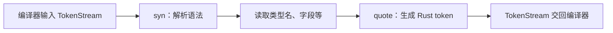

# 9.4 常用的宏开发库

| 库 | 用途 |
| --- | --- |
| [`proc-macro2`](https://docs.rs/proc-macro2/) | 可在普通 crate 和测试中使用的 token 类型 |
| [`syn`](https://docs.rs/syn/) | 把 Rust token 解析为结构化数据，如 `DeriveInput` |
| [`quote`](https://docs.rs/quote/) | 用类似 Rust 代码的模板生成 token |



上一节的派生宏可以用 `syn` 读取类型名，再用 `quote!` 生成实现。模板里的 `#name` 插入标识符；`proc_macro2::TokenStream` 可用 `.into()` 转为编译器所需的 `proc_macro::TokenStream`。

::: tip 新版变化
Edition 2024 保留了 `gen` 关键字。旧代码中的 `let gen = quote! { … };` 可改用 `let generated = …;`，或写成 `let r#gen = …;`。
:::

下面的 `quote!` 示例不需要过程宏 crate。新建 Edition 2024 二进制项目，执行 `cargo add quote`，保存为 `src/main.rs` 后运行 `cargo run`：

```rs
use quote::quote;

fn main() {
    let name = quote!(x);
    let generated = quote!(let #name = 42;);
    assert_eq!(generated.to_string(), "let x = 42 ;");
}
```

> 进一步练习：[过程宏工作坊](https://github.com/dtolnay/proc-macro-workshop)。
